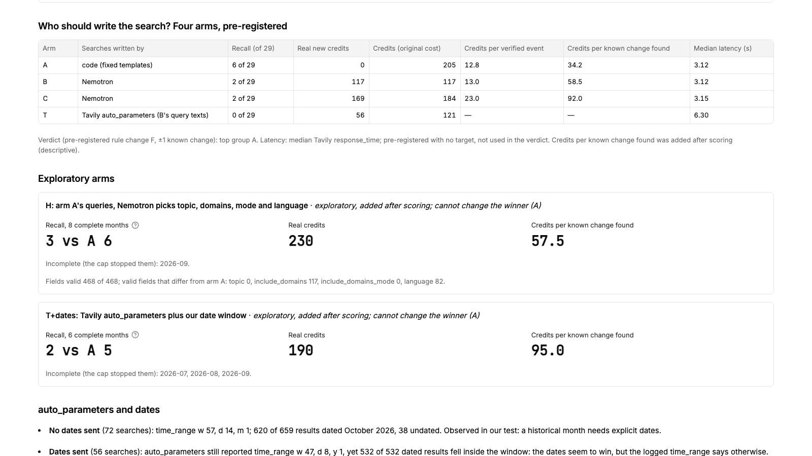
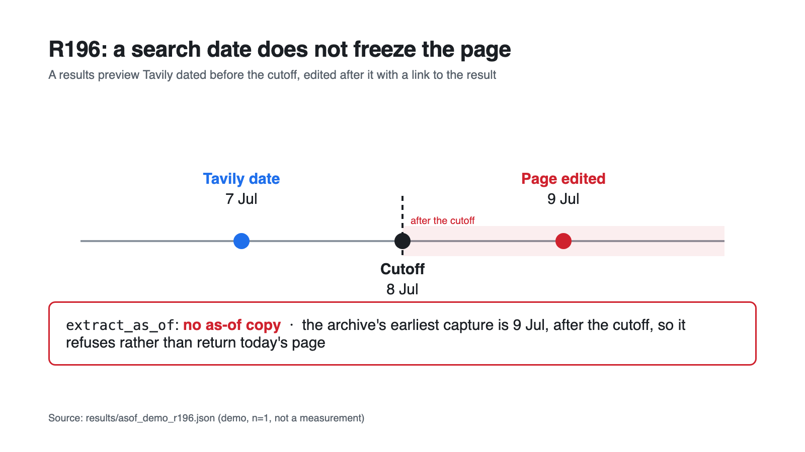
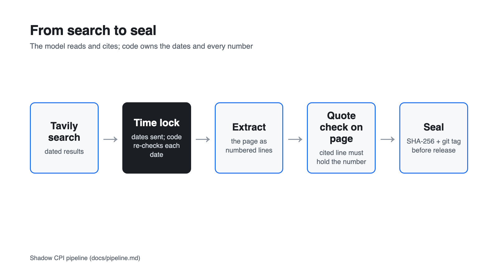
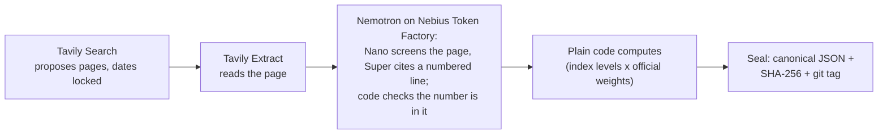

<!-- Generated by tools/sync_doc_numbers.py from docs/templates/README.md: edit the template, not this file. -->
# Shadow CPI

[](https://github.com/bhavikjain026/shadow-cpi/actions/workflows/tests.yml)

## Can a search engine keep the past in the past? We measured Tavily's date controls.

**Time-locked web evidence for AI on Tavily: date-bounded search, as-of reading from archives (or a refusal), and code-checked citations, used to seal India's monthly inflation estimate.**

In the forecast pipeline, NVIDIA Nemotron on Nebius Token Factory screens pages and cites quotes; code checks each cited number on the page.

| Leaks, measured (pre-registered initial pass) | No dates | Dates + filter |
|---|---|---|
| Date test (20 cases) | **9 of 20** (Wilson 26–66%) | **0 of 20 detected** (Wilson 0–16%) |
| Replication (22 new cases, pre-registered) | **14 of 22** (Wilson 43–80%) | **0 of 22 detected** (Wilson 0–15%) |
| Finance check (14 cases, exploratory, different leak rule) | 2 of 14 (4–40%) | 0 of 14 detected (0–22%) |

Pilot + replication, date-test rule (pre-registered secondary): dates + filter 0 of 42 detected (Wilson 0–8%;
post-hoc rule of three: below 7.1%). No-dates counts are lower bounds: a leak counts only when the Wayback
Machine confirms it, and a page the archive never captured is not counted (absence from Wayback is not proof the page
did not exist). Explicit date windows already gave 0 of 20 detected (`start_date`/`end_date` only,
Wilson 0–16%); the filter additionally drops undated pages (the dates-only search returned
0 undated of 58 results here).

Separate rules; never added together. **Update:** date test 10 of 20 with no dates (Wilson
30–70%) after retrying the 11 archive lookups that had failed, still 0 of
20 detected with dates + filter; finance check 10 of 14 (45–88%) after the
retry (94 lookups had failed), still 0 of 14 detected with dates + filter.

| | |
|---|---|
| [](docs/gallery/README.md#the-opening-screen) | [](docs/gallery/README.md) |
| [](docs/gallery/README.md) | [](docs/gallery/README.md) |

<details>
<summary>Footnote: what counts as a leak, and the update after the archive retry</summary>

- **Dates + filter** means `start_date`/`end_date` plus `filter_by_published_date`; no dates means neither.
- **Date test** (pilot, replay cases; [`v2/DATE_TEST_PREREG.md`](v2/DATE_TEST_PREREG.md)). A case leaks when at least
  one result the search kept is a confirmed leak: "**Confirmed leak (L):** independent version evidence only: the Wayback Machine CDX API (a logged direct download, the same exception as MoSPI) lists **no capture on or before the cutoff**, its first capture is after the cutoff, **and** Tavily's published date or the date in the address is after the cutoff."
- **Replication** (22 new cases, none from the pilot; [`v2/REPLICATION_PREREG.md`](v2/REPLICATION_PREREG.md)).
  The date test's leak rule and arms (no dates; dates + filter), cutoff the day before each price change, run once
  ([`results/replication.md`](results/replication.md)). The pooled line adds pilot and replication under the same rule,
  as pre-registered (secondary).
- **Cache note on the replication** (logged addendum in `results/replication.md`; descriptive, not pre-registered).
  Every call goes through our cache, and 4 no-dates answers were served from it, 3 of
  them the pilot's own response to the same query; the time-locked searches were all fresh. Without the
  3 cases that reused the pilot's response: no dates 11 of 19
  (Wilson 36–77%), dates + filter 0 of 19 (0–17%). The
  pooled no-dates count (23 of 42) includes that reused pilot response.
- **Finance check** (exploratory, Reserve Bank of India (RBI) decisions and company results;
  [`v2/FINANCE_PREREG.md`](v2/FINANCE_PREREG.md), as amended). A different rule, so its counts are reported apart:
  "**Confirmed leak:** states the outcome **and** Wayback-confirmed (no capture on or before the cutoff, first capture after it, and Tavily's or the address's date after the cutoff)."
- **Initial pass** (the table): the pre-registered result and the primary count.
- **The update, after the logged archive retry.** A logged retry re-ran only the archive lookups that had failed, with
  the same labelling rules. On the initial pass, 94 finance-check archive lookups (and 11 in the date test) failed
  for network reasons, so those pages could only be flagged, not confirmed; the retry recovered all of them,
  which is why the finance count rises from 2 to 10 of 14. Wilson 95% intervals
  after the retry: date test no dates 30–70%, dates + filter 0–16%; finance check no
  dates 45–88%, dates + filter 0–22%.
- **Statistics (post-hoc, not pre-registered; [`results/posthoc_stats.md`](results/posthoc_stats.md)).** Exact McNemar, no
  dates vs dates + filter, paired by case on the initial pass: date test p = 0.0039, replication p =
  0.00012, finance check p = 0.5, pooled p = 2.4e-07. For the pooled 0 of
  42 detected, the rule of three puts the leak rate below 7.1% with about 95% confidence (exact
  one-sided bound 6.9%). Without the cache-served replication responses: no dates 11 of
  19, dates + filter 0 of 19 detected (the logged addendum, reused).

</details>

**The cost.** The measured cost of the strict setting: the filter dropped 12 of the date test's
40 pieces of valid evidence (initial pass; 20 of 48 after
the retry).

**Date filters select which pages, not which version.** Tavily dated `R196`, a TCS results preview,
7 Jul, before its 8 Jul cutoff; the page was updated on 9 Jul with a link to the actual
result, and Extract returns the updated page. `max_age_hours` controls freshness, not as-of; `extract_as_of` fills that
gap (demo, n=1) ([details](#search-dates-do-not-freeze-page-content)). What Tavily's own docs say about each field,
next to what we measured: [below](#what-tavilys-docs-say-vs-what-we-measured).

**Reuse it:** [`timelock/`](timelock/) (time-locked search, standard library only,
[10-line example](#use-it-in-10-lines)) · [`mcp/`](mcp/README.md) (the same as an MCP
tool) · [`benchmarks/timelock34/`](benchmarks/timelock34/DATASHEET.md) (the labelled benchmark and scorer) · [](https://colab.research.google.com/github/bhavikjain026/shadow-cpi/blob/main/notebooks/reproduce_leak.ipynb) reproduce the leak with your own Tavily key ([`repro/`](repro/README.md) for the Tavily items).

**Live app:** https://shadow-cpi.streamlit.app · **Demo video:** [TBD] · **Devpost:** [TBD]

> **Required technologies**
>
> - **Nebius Token Factory**, endpoint host `api.tokenfactory.nebius.com` (OpenAI-compatible; [`shadow_cpi/nemotron.py`](shadow_cpi/nemotron.py))
> - **NVIDIA Nemotron Nano**, `nvidia/NVIDIA-Nemotron-3-Nano-30B-A3B` (from 9 Nov 2026: `nvidia/Nemotron-3_5-Lightning`): yes/no gatekeeper ("does this page state an Indian price or price
>   change?") and display-only English glosses
> - **NVIDIA Nemotron Super**, `nvidia/nemotron-3-super-120b-a12b` (from 9 Nov 2026: `nvidia/Nemotron-3.5-Super-VL`): reads the page and cites the line for each price and price change;
>   writes the search fields in arms B, C and H
> - Model roles: [`config/models.json`](config/models.json). Nebius retires the original IDs on 9 Nov 2026; from then, calls use Nebius's recommended replacements (pre-registered on 27 Oct).
> - **Tavily API** endpoints used: `/search`, `/extract`, `/map`, `/crawl` (and `/usage` for the balance)

## Time-locked search leakage

The Tavily field report (app page "Tavily field report", built by `tools/build_field_report.py` into
[`results/field_report.json`](results/field_report.json)), summarised. Each check has its own pre-registered leak
rule and its own count; date-test and finance counts are never added together.

- **Date test (pilot, 20 replay cases, [`v2/DATE_TEST_PREREG.md`](v2/DATE_TEST_PREREG.md)).** Rule quoted
  above. Pre-registered initial pass: no dates 9 of 20 (26–66%), dates + filter
  0 of 20 detected (0–16%). Update: 10 of 20 and 0
  of 20 after retrying the 11 archive lookups that had failed. Every case whose label changed
  after the retry (9 of 34, both checks), with the reason:
  [`docs/retry_reconciliation.md`](docs/retry_reconciliation.md).
- **Finance check (exploratory, 14 Reserve Bank of India (RBI) decisions and company results,
  [`v2/FINANCE_PREREG.md`](v2/FINANCE_PREREG.md)).** Rule quoted above (it also needs the title or snippet to state
  the outcome). The day-before search with no dates leaked the outcome for 2 of 14
  events on the pre-registered initial pass (Wilson 95% 4–40%); with dates and the filter,
  0 of 14 detected (0–22%). Update: 10 of 14
  (45–88%) and 0 of 14 (0–22%) after the retry
  (94 lookups had failed).
- **Tasks and calls.** Each task sent one search per setting, so call counts equal task counts
  (9 of 20 date-test calls and 2 of
  14 finance calls with no dates leaked on the initial pass;
  [`results/date_field_test.json`](results/date_field_test.json),
  [`results/finance_lookahead.json`](results/finance_lookahead.json)).
- **Check P, full page (exploratory, [`results/leakcheck_full_page.md`](results/leakcheck_full_page.md)).** Of
  132 pages that passed the date lock (Tavily's filter, or our own date check), 1 described an event
  after the cutoff. 71 pages held a later date somewhere in the text, mostly as page furniture; each has
  one outcome: 1 later content (the page just counted), 43 in date bars, sidebars and related
  links, 21 benign, 6 unclear.
- **Receipt.** Credits and latency per setting are in the table; every call is in the flight recorder and the
  credit ledger.

**Leak counts** (case level; the pre-registered initial pass is the primary count, after the logged archive retry is
the update):

| Check (unit) | Setting | Leak cases, pre-registered initial pass (Wilson 95%) | After the logged archive retry (Wilson 95%) | Credits per call | Median latency |
|---|---|---|---|---|---|
| Date test (20 replay cases), cases | no dates | **9 of 20** (26–66%) | 10 of 20 (30–70%) | 1.00 | 3.8 s |
| Date test (20 replay cases), cases | start_date + end_date | **0 of 20** (0–16%) | 0 of 20 (0–16%) | 1.00 | 3.4 s |
| Date test (20 replay cases), cases | start_date + end_date + filter_by_published_date | **0 of 20** (0–16%) | 0 of 20 (0–16%) | 1.00 | 3.5 s |
| Date test (20 replay cases), cases | start_date + end_date + filter_by_published_date + our page check | **0 of 20** (0–16%) | 0 of 20 (0–16%) | 0.94 | 3.2 s |
| Replication (22 new cases, pre-registered), cases | no dates | **14 of 22** (43–80%) | 19 of 22 (67–95%) | 1.00 | 3.6 s |
| Replication (22 new cases, pre-registered), cases | start_date + end_date + filter_by_published_date | **0 of 22** (0–15%) | 0 of 22 (0–15%) | 1.00 | 3.7 s |
| Finance check (14 scheduled events), events | no dates | **2 of 14** (4–40%) | 10 of 14 (45–88%) | 1.00 | 3.2 s |
| Finance check (14 scheduled events), events | start_date + end_date + filter_by_published_date | **0 of 14** (0–22%) | 0 of 14 (0–22%) | 1.00 | 1.4 s |

**Valid evidence kept** (initial pass; each check has its own denominator):

| Check | What is counted | Kept with dates + filter | Lost |
|---|---|---|---|
| Date test (pilot) | valid evidence: pages Wayback shows existed by the cutoff that name the item | 28 of 40 | 12 |
| Finance check (exploratory) | valid evidence: pages Wayback shows existed by the cutoff that name the RBI or the company | 10 of 11 | 1 |
| Check E (exploratory, `exact_match`) | known-good quotes re-found by the dated search | 25 of 40 | 8 found only without dates; 7 by neither |

With our extra page-date check added to the filter, 27 of the date test's 40
pieces of valid evidence were lost (initial pass; 35 of 48 after the
retry). Check E's misses are filter misses, not back-dating: 0 of
8 have a Tavily `published_date` after the cutoff (6 on or before it,
2 undated; [`results/leakcheck_exact_match.md`](results/leakcheck_exact_match.md)).

Small samples: every rate in the field report carries a Wilson interval (95%).

## What Tavily's docs say vs what we measured

Each row quotes Tavily's API reference ([Search](https://docs.tavily.com/documentation/api-reference/endpoint/search), [Extract](https://docs.tavily.com/documentation/api-reference/endpoint/extract)) and puts
our measurement next to it. Most of what we found is documented behaviour; the field notes below tag each item
"documented behaviour", "doc gap" or "unexplained".

| Field | Tavily's docs say (quoted, checked 29 Oct) | What we measured |
|---|---|---|
| `start_date` / `end_date` | ["Will return all results after the specified start date based on publish date or last updated date."](https://docs.tavily.com/documentation/api-reference/endpoint/search); ["By default, results with no detectable published date are not removed"](https://docs.tavily.com/documentation/api-reference/endpoint/search) | Dates select which pages, not which version. `R196`: dated 7 Jul, before its 8 Jul cutoff, updated 9 Jul; Extract returns the updated page. Dates with the filter off (arm B): 0 of 20 detected (Wilson 0–16%) |
| `filter_by_published_date` | ["Results with no detectable published date are also removed."](https://docs.tavily.com/documentation/api-reference/endpoint/search) | Dates + filter: 0 of 20 detected (Wilson 0–16%); replication 0 of 22 detected (0–15%). Measured cost of the strict setting: 12 of 40 pieces of valid evidence dropped (initial pass); undated results 0 with the filter, 8 of 60 with no dates |
| The docs' alternative: `include_published_date` without the filter | ["leave this `false` and set `include_published_date: true` together with a date range instead."](https://docs.tavily.com/documentation/api-reference/endpoint/search) | Our arm B is that setting (dates, `include_published_date` on, filter off): 0 of 20 detected (0–16%), 0 undated of 58 results, 19 of 40 pieces of valid evidence lost (filter on: 12) |
| `published_date` | ["Tavily's best estimate of when the source was published or last updated."](https://docs.tavily.com/documentation/api-reference/endpoint/search) | Later than the page's own date on 4 of 42 distinct date-test pages: documented behaviour (feature request: separate the two dates) |
| `time_range` | ["The time range back from the current date to filter results"](https://docs.tavily.com/documentation/api-reference/endpoint/search) | `auto_parameters` with no dates chose recent time ranges for past months: 620 of 659 results from October 2026 (observed once on 22 Oct 2026, not reproduced on 27 Oct 2026). Consistent with "back from the current date"; a past month needs `start_date`/`end_date` |
| `max_age_hours` | ["The maximum age in hours of Tavily's cached copy of each result."](https://docs.tavily.com/documentation/api-reference/endpoint/search) | Not sent in our runs. It bounds how fresh Tavily's cached copy is, not which date the copy reflects (freshness, not as-of); the [Extract reference](https://docs.tavily.com/documentation/api-reference/endpoint/extract) lists no date, cache or crawl-time field. `extract_as_of` fills that gap (demo, n=1: `R196` refused, no archive copy before the 8 Jul cutoff) |
| `language` vs `filter_by_language` | ["Boost search results in a specific language."](https://docs.tavily.com/documentation/api-reference/endpoint/search); ["Strictly filter out search results that don't match the `language` parameter, instead of only boosting them in ranking."](https://docs.tavily.com/documentation/api-reference/endpoint/search) | We sent `language` without `filter_by_language` (boost only) on 12 cases: with dates + filter 0 of 12 detected (0–24%); Tamil still returned English pages (post-hoc), as boost-only allows. `filter_by_language` was not tested |

## Search dates do not freeze page content

Date filters select which pages, not which version: Tavily's date filter works on a page's publish or last-updated
date, and Extract returns the page as it is when we call it. A page dated before the cutoff can be updated after it,
and the filter cannot see that. `max_age_hours` bounds how fresh Tavily's cached copy is (freshness, not as-of), and
the Extract reference lists no date field. `extract_as_of` fills that gap (demo, n=1, below). Example (from a separate, post-hoc AI-assisted
review (ChatGPT agent); 146 of 283 rows stayed unclear): `R196`, a TCS results
preview in the finance check, cutoff 8 Jul. Tavily dated it 7 Jul, before the cutoff; the page
was updated on 9 Jul with a link to the actual result. In the finance check, 0 of
14 filtered searches returned a result dated after the cutoff, and that review still found
1 page whose current version leaks the outcome. Three things cover the gap, none of them
completely:

- **Our page-date check** reads the date printed on the extracted page and drops anything after the cutoff. In the
  date test it kept 26 of the 59 results the filter let through; with it,
  27 of the date test's 40 pieces of valid evidence were lost (12 with the filter
  alone; initial pass). It reads a page's date, not its edit history.
- **The drift monitor** re-reads each October radar page with Extract once a day and compares it with the saved copy
  ([`v2/DRIFT_PREREG.md`](v2/DRIFT_PREREG.md)): 2 runs committed (28 Oct 2026 to 29 Oct 2026 IST), 142 page checks, 31 changes found; in the latest run, 17 of 80 radar pages had changed since they were saved; cited quote still present on 16 of 17; cited number changed on 0 of 17.
- **The Wayback Machine** shows whether a page existed by the cutoff; a leak counts only when it confirms one. Failed
  lookups were retried and logged (11 in the date test, 94 in the finance check). In
  the post-hoc review, 146 of 283 rows stayed unclear, partly because archive lookups were
  rate-limited.

## Who writes the search: model-written fields vs fixed templates, inside a time lock it cannot move

Tavily's dynamic filtering lets a model choose its own search fields. We built on that idea and tested it on
29 known retail price changes in Jan–Sep 2026 (pre-registered in
[`v2/PREREGISTRATION.md`](v2/PREREGISTRATION.md); [`results/v2_ablation.md`](results/v2_ablation.md)):

| Arm | Who writes the search | Known changes found |
|---|---|---|
| A | code, fixed templates | 6 of 29 |
| B | Nemotron Super (English, Hindi) | 2 of 29 |
| C | Nemotron Super (7 languages: English, Hindi and regional) | 2 of 29 |
| T | Tavily `auto_parameters`, no dates | 0 of 29 |
| H (exploratory, added after scoring) | templates + model-chosen fields | 4 of 29 (3 vs A's 6 on the 8 months H completed) |
| T+dates (exploratory, added after scoring) | `auto_parameters` + our dates | 2 of 29 (6 of 9 months complete) |

- **The fields were always valid.** Every field the model wrote was a proper Tavily parameter, dates included:
  189 of 189 searches in arms B and C, 468 of 468 in arm H.
- **Fixed templates still found more.** This is a result about query planning (what Nemotron chose to search for),
  not about Tavily: the same Tavily endpoint answered every arm. The likely cause is source choice: arm H differed
  from arm A only in `include_domains` (117 searches) and `language` (82).
- **`auto_parameters` with no dates reached for the present (an observation).** On 72 searches about
  past months it picked recent time ranges, and 620 of 659 results were from October 2026
  (observed once on 22 Oct 2026, not reproduced on 27 Oct 2026); Tavily documents `time_range` as counting back from the current date. With our dates added,
  532 of 532 dated results fell inside the window.

So the time lock lives in code: the model may choose the query, topic, domains and language; code owns the dates.

## Tavily field notes / repro kit

Publishing these measurements was approved by <who, role> on <date> (<link>).
Screenshot: [`docs/permission_2026-10-27.png`](docs/permission_2026-10-27.png).

Full notes with observed / expected / suggested change / evidence (counts and Tavily request IDs) and a one-request
repro script each: [`docs/tavily_bug_reports.md`](docs/tavily_bug_reports.md), built from
[`results/bug_reports.json`](results/bug_reports.json). Each is tagged against Tavily's docs: **documented behaviour**,
**doc gap** or **unexplained**.

**Feature requests (2)**

- **An as-of / crawl-timestamp field** (documented behaviour). Date filters select which pages, not which version:
  `R196` (above) was dated before the cutoff and updated after it, and Extract returns today's copy.
  `max_age_hours` controls freshness, not as-of. `extract_as_of` fills that gap (demo, n=1); a field saying when the
  returned copy was fetched would let any time-locked user check it.
- **Separate original-publication and last-modified dates** (documented behaviour). `published_date` was later than
  the page's own date on 4 of 42 distinct date-test pages, as Tavily's documented definition
  (published or last updated, beta) allows.

**Observations**

- **`auto_parameters` picked a recent `time_range` for queries about a past month** (unexplained;
  observed once on 22 Oct 2026, not reproduced on 27 Oct 2026). With no dates, on 72 searches naming a month in Jan–Sep 2026, 620 of
  659 results came from October 2026.
- **With explicit dates, the `auto_parameters` echo still reports a `time_range`** (doc gap). On 56
  searches with our `start_date`/`end_date`, the echo said `time_range` w 47, d 8, y 1 and held a start or end date
  in 0 of them, while 532 of 532 dated results fell inside our window: the
  dates were applied, the echo does not say so.
- **Map's silent empty answer** (unexplained): 5 of 5 official crawl-list sites
  (state electricity regulators, IOCL, Amul) and 3 of 7 dairy sites, with no error or
  `failed_results`.
- **One scanned PDF** (doc gap): on one scanned dairy rate-list PDF, Extract returned the letterhead but not the
  image-only rates.
- **`/usage` lag** (doc gap): `/usage` reported 6 credits used while per-call `include_usage` added
  up to 226 the same day.

Also measured: the filter drops undated pages (8 of 60 results undated with
no dates, 0 with the filter), and the Research endpoint has no date window (checked in the API
reference on 26 Oct; not measured).

## Tavily integration map

Every Tavily endpoint and parameter we use or refuse, what we do with it and why; each row is checked against the code
in `tests/test_sync_doc_numbers.py`.

| Endpoint / parameter | How we use it | Why |
|---|---|---|
| `start_date` / `end_date` (Search) | Every time-locked search sends a window that ends on the cutoff; an `end_date` after the cutoff is refused. | The first lock: Tavily only returns pages dated inside the window. |
| `filter_by_published_date` (Search) | Always on inside the time lock; it cannot be switched off there. The date test also ran it off, to measure it. | Also removes results with no detectable date; we measured what that costs. |
| `include_published_date` (Search) | Set on the Try it page, the Leak demo's live mode and the MCP search tool, so each result carries Tavily's date; code then re-checks every date and labels the result safe, date flag or leak. | A date is Tavily's estimate, so code does not take it on trust. |
| `/extract` | Reads each page the pipeline cites. The model returns a line number; code copies that line from the Extract output and checks the number is in it. `extract_as_of` pairs it with Wayback. | Extract returns the page as it is today, so a page edited after the cutoff needs the archive copy. |
| `/map` and `/crawl` | Look for the pages that hold official price lists and tariff orders. | Official sources publish lists, not news. Map returned nothing on several government and dairy sites (a field note). |
| `include_usage` | Sent on every call, by the app's client and by the standalone `timelock` client, and the credits are written to the call log and the credit ledger. | To cap spend per run and report credits per result. |
| `X-Project-ID: shadow-cpi` (header) | Sent on calls to api.tavily.com from the app's HTTP layer. The standalone `timelock` package and the MCP server do not send it, and it is not part of any cache key. | Tavily groups usage by project. |
| MCP tools (`mcp/server.py`) | `search` (the time-locked search), `as_of` (`extract_as_of`) and `check_leaks` (labels results you already have, no Tavily call). They reach Tavily through `timelock.TavilyHTTP` with your own key. | The same lock for any agent. |
| We refuse: `time_range`, `days`, `auto_parameters` | The time lock raises an error before any call if a request carries one of them, or switches the filter off. | They set their own window. `auto_parameters` with no dates reached for the present: 620 of 659 results for past-month queries came from October 2026 (observed once on 22 Oct 2026, not reproduced on 27 Oct 2026). |
| Direct download (outside Tavily) | Official data is fetched directly and logged as service `direct`: the MoSPI API, and the Department of Consumer Affairs price pages, some saved by hand because they sit behind a captcha. `extract_or_download` falls back to a direct download when Extract cannot fetch a page; it is called from one place, the DoCA check in `checks.py`. | Some government sites block Extract. These downloads do not go through Tavily's date filter; the exact-line number check still applies, and every call is logged. |

## Reuse it

### Use it in 10 lines

Install the time-lock package alone (works once the `submission-v1.0` tag exists, from Friday; until then
install from a clone with `pip install .`):

```bash
pip install "git+https://github.com/bhavikjain026/shadow-cpi@submission-v1.0"
```

[`timelock/`](timelock/) needs no part of the CPI pipeline and no package outside the Python standard library.
`timelocked_search(client, query, cutoff, **tavily_kwargs)` sends `start_date`/`end_date` and
`filter_by_published_date=true`, refuses an `end_date` after the cutoff (or `time_range`, `days`,
`auto_parameters`, or the filter switched off) before any call, and returns Tavily's results, each with
`published_date`, `page_date` (when the page text was extracted), `status` (`safe` / `date_flag` / `leak`),
`request_id` and `response_sha256`. A result dated after the cutoff is a `leak` even if Tavily's filter let it through.
A cutoff date means the end of that day in UTC: results dated on or before it (in UTC) pass; for IST, a page published `00:00–05:30` IST on the next day still counts as the cutoff day, so pass the previous day if you need a strict IST cutoff.

The cutoff day is inside the window. `end_date` is sent as the cutoff itself, never the day after (Tavily's reference
says only "before the specified end date", so we do not rely on it keeping that day; at worst we lose cutoff-day pages),
and a `published_date` counts by its UTC calendar date against the cutoff date: a page stamped
`Tue, 06 Oct 2026 23:59:59 GMT` is safe at cutoff `2026-10-06`, `Wed, 07 Oct 2026 00:00:00 GMT` is a `leak`. Edge: a
page published after `18:30` UTC on the cutoff day is already the next day in IST but is labelled `safe`; pick the day
before as the cutoff if that matters.

```python
import sys
from pathlib import Path

from timelock import Replay, TavilyHTTP, timelocked_search

saved = Path(__file__).resolve().parent.parent / "tests/fixtures/timelock/rbi_2026-10-06_locked.json"
client = TavilyHTTP() if "--live" in sys.argv else Replay(saved)          # live costs 1 Tavily credit
results = timelocked_search(client, "RBI monetary policy repo rate decision October 2026", cutoff="2026-10-06",
                            topic="news", search_depth="basic", max_results=5, include_published_date=True)
for r in results:
    print(r["status"], r["published_date"], r["url"])
print(results.counts, results.request_id, results.response_sha256[:12])
```

```bash
python -m examples.timelock_rbi                              # offline: a saved Tavily response, 0 credits
TAVILY_API_KEY=... python -m examples.timelock_rbi --live    # live
```

Offline it replays a real saved response (`tests/fixtures/timelock/`, request ID and hash checked in
[`tests/test_timelock.py`](tests/test_timelock.py)); `Replay` refuses any other request. Any client with
`.search(query, **kwargs) -> dict` works, including tavily-python's `TavilyClient`.

- **LangChain:** `TimeLockedTavilySearch(cutoff=...)` in [`timelock/langchain.py`](timelock/langchain.py) is a drop-in search tool for an agent's tool list with a fixed cutoff, `time_range`/`days`/`auto_parameters` refused and only `safe` results returned (`pip install ".[langchain]"`; [short example](examples/langchain_timelock.py)).
- **MCP `check_leaks(results_json, cutoff)`:** audits results from any search tool with no API call: counts safe / undated / after-cutoff and lists the URLs to re-read with `extract_as_of` ([`mcp/`](mcp/README.md)).

### Report back to Tavily (optional, off by default)

Tavily's feedback endpoint (`POST https://api.tavily.com/feedback`) is in beta: its docs say the request shape may still change and that a failure should be treated as non-fatal. Submitting feedback is free and uses no API credits ([reference](https://docs.tavily.com/documentation/api-reference/endpoint/feedback)). This is off by default. `check_leaks(..., report_to_tavily=True)` on the MCP server reports only results our check labels `leak`, and only from our own date-filtered requests: the request must be one this server made (or one listed in the file named by `TIMELOCK_LEDGER`) and must have sent an `end_date`. Undated control searches are never reported, because a leak there is not a fault of Tavily's filter. It needs `TAVILY_API_KEY` and sends the leaking result's URL and the dates we saw, so leave it off unless you want that. In code, `timelock.send_feedback(...)` is a dry run unless you pass `dry_run=False`, and a failed send is returned, not raised.

### Read a page as it was on the cutoff

Search dates do not freeze page content: Extract returns a page as it is today, so a page dated before the cutoff
can carry a link to the result it previewed. `extract_as_of(client, url, cutoff)` extracts the live page and checks
its change evidence (Tavily's date, the page's own published/updated date, Wayback captures). If the page may have
changed after the cutoff it returns the latest Wayback capture on or before the cutoff instead, with provenance
`{source: "tavily_live" | "wayback_asof", capture_time, reason}` (plus `capture_timestamp` and `capture_digest` for a
Wayback copy; only captures with status `200` on or before the cutoff are used); if there is no such capture, it returns no text
and the reason `no as-of copy`, never the live page. When nothing suggests a change but the Wayback Machine holds no
capture on or before the cutoff, the live page comes back labelled `unverified: no archive copy before the cutoff`;
pass `strict=True` to refuse it instead. If Extract answers for a different address (compared ignoring the scheme and
a trailing slash), it returns no text and the reason `url mismatch`, never another page's text. Wayback is a direct
download outside Tavily.

Two demos (one page each, not a measurement): on R196 it refused, because the Wayback Machine holds
no copy on or before the 8 Jul cutoff
([`results/asof_demo_r196.json`](results/asof_demo_r196.json)). On case E2, picked by a rule fixed
before any call, it served the 21 Apr 2026 copy, which writes no date after the 29 Apr
cutoff, while the live Extract writes 2 dates after it (1 Jul 2026, 31 Mar 2031; a date in
the text is not always an update)
([`results/asof_demo_served.json`](results/asof_demo_served.json)).

```python
from timelock import TavilyHTTP, extract_as_of, timelocked_search

client, cutoff = TavilyHTTP(), "2026-10-06"                     # 1 search credit + 1 Extract credit per page
results = timelocked_search(client, "RBI monetary policy repo rate decision October 2026", cutoff, topic="news",
                            max_results=3, include_published_date=True)
for r in results:
    page = extract_as_of(client, r["url"], cutoff, published_date=r.get("published_date"))
    print(r["status"], r["url"], page["provenance"])
    print((page["text"] or "no as-of copy: do not use this page")[:300])
```

- **MCP server** [`mcp/`](mcp/README.md): `timelocked_search` and `extract_as_of` as tools for Claude Code, Claude
  Desktop or any MCP client; results after the cutoff come back as domain and date only, never their text or URL.
- **Benchmark** [`benchmarks/timelock34/`](benchmarks/timelock34/DATASHEET.md): 34 cases,
  32 distinct questions (two pairs share a question and its searches), from the date test and the
  finance check, with every result URL labelled (Wayback-confirmed leak, date flag, unknown) and a scorer for any
  search function (leak rate with Wilson intervals, valid evidence kept). New URLs a search returns are unlabelled
  until reviewed and are never counted as safe. Labels under CC BY.
- **`shadow_cpi/pit`** ([`shadow_cpi/pit/README.md`](shadow_cpi/pit/README.md)): the pipeline's wrapper around
  `timelock/`, adding the Flight Recorder and a month-start window.
- **Agent skill** [`skills/time-locked-search/SKILL.md`](skills/time-locked-search/SKILL.md): the same rules for any
  agent that searches the past.

### For research teams

Shadow CPI doesn't claim to solve temporal leakage. It makes retrieval-based backtests auditable: dates are enforced in code, every retrieval is logged and timestamped, results come with their uncertainty, and live forecasts are sealed before the official release. Not adopted by any team yet. Exports (`python tools/export.py`, columns in
[`docs/exports_schema.md`](docs/exports_schema.md)), `as_of()`, the seal checks and the leak checker
([`timelock/check.py`](timelock/check.py), example in
[`examples/leakcheck_example.py`](examples/leakcheck_example.py)). Research tool, not investment advice.

## The problem

India's official Consumer Price Index (CPI) inflation figure, published by the Ministry of Statistics and Programme
Implementation (MoSPI), arrives about 12 days after the month ends. So anyone forecasting it from the web
has to replay past months, and a replay that quietly reads a page published after its cutoff looks better than it
could ever be live (look-ahead bias).

Shadow CPI is a Tavily-grounded India CPI nowcast that tests, rather than assumes, Tavily's date controls and measures
what they cost. El Lahib et al. (2026, [arXiv 2602.00758](https://arxiv.org/abs/2602.00758)) found
at least one retrieved page containing major post-cutoff leakage for 71% of Google-audited questions, after 10–20 queries
and about 100 URLs each; our 9/20 on the pre-registered initial pass (10/20 after the logged archive retry) is per search task, so the rates are not directly
comparable.

### Related work

Shadow CPI is a pre-registered measurement of an agent-native search API's date controls, plus a shipped fix for the gap it found (time-locked search and an as-of page reader). Related studies, each checked on its arXiv page:

- **El Lahib et al. 2026**: "Temporal Leakage in Search-Engine Date-Filtered Web Retrieval: A Retrospective Forecasting Case Study": audits post-cutoff leakage in Google and DuckDuckGo date-filtered retrieval for forecasting questions (https://arxiv.org/abs/2602.00758).
- **OracleProto (Ma et al. 2026)**: a reproducible framework for benchmarking LLM forecasting via knowledge cutoffs and temporal masking (https://arxiv.org/abs/2605.03762).
- **LiveMacroEval (Zhao et al. 2026)**: "Can LLMs Take the Pulse of the Economy?": live LLM nowcasts of 16 US macro indicators (https://arxiv.org/abs/2608.30110).
- **Paleka, Goel, Geiping and Tramèr 2025**: "Pitfalls in Evaluating Language Model Forecasters": temporal leakage as a reason to distrust forecasting evaluations (https://arxiv.org/abs/2506.00723).
- **Zhang and Stadie 2026**: "Temporal Leakage in LLM Backtesting: Measurement, Validation, and Adjusted Scores": leakage from model memory, measured against a known training cutoff and a matched clean control (https://arxiv.org/abs/2608.02985).

## How it works



1. **Tavily Search proposes.** Every search carries `start_date`/`end_date`; the later time-locked searches (date
   test, radar, `timelock/`) also send `filter_by_published_date`. Code re-checks each result's date and drops
   anything after the cutoff. v1's frozen evidence search used the dates plus our page-date check only.
2. **Tavily Extract reads the page.** A snippet is a pointer, not evidence. The model returns a line number; code
   copies that line from the Extract output and checks the number is in it. A model never writes a quote.
3. **Plain code computes.** Index levels combined with MoSPI's official weights, year-on-year last. A model never
   picks a number, a range or a weight.
4. **The seal.** Canonical JSON, its `SHA-256`, and a git tag. We publish the prediction's SHA-256 and a Git tag
   before release, so anyone can verify the file they have. The seal proves when the forecast was
   committed, not what was read before it; the time lock and `extract_as_of` address the evidence.

## How we use NVIDIA Nemotron on Nebius Token Factory

Nano screens pages, Super cites the exact line, code checks the number. Nemotron Nano answers one yes/no question
per page ("does this page state an Indian price or price change?"); Nemotron Super reads the page as numbered lines
and returns the line number for each price; code copies that line from the Extract output and keeps the claim only
if the number is in it. A model never writes a quote, a number, a range or a weight. Two models, one
OpenAI-compatible endpoint ([`shadow_cpi/nemotron.py`](shadow_cpi/nemotron.py)); calls from the flight recorder
([`results/app/flight_recorder.jsonl`](results/app/flight_recorder.jsonl)):

| Model (Token Factory ID) | From 9 Nov 2026 (Nebius's replacement) | Job | Calls sent (including cache hits) |
|---|---|---|---|
| Nemotron Nano, `nvidia/NVIDIA-Nemotron-3-Nano-30B-A3B` | `nvidia/Nemotron-3_5-Lightning` | Gatekeeper: "does this page state an Indian price or price change?" (yes/no); English glosses of non-English quotes, for display only | 622 (4,829) |
| Nemotron Super, `nvidia/nemotron-3-super-120b-a12b` | `nvidia/Nemotron-3.5-Super-VL` | Reads pages and cites the line for each price and price change; writes the search fields in arms B, C and H | 719 (5,177) |

**The dated model switch on 9 Nov 2026.** Nebius retires the original IDs on 9 Nov 2026; from then, calls
use Nebius's recommended replacements (pre-registered on 27 Oct). The model is picked by the call
date in IST ([`config/models.json`](config/models.json)) and logged with every call; the October 2026 seal uses the
original models ([`v2/PREREGISTRATION.md`](v2/PREREGISTRATION.md), Amendment G).

**Where Token Factory helped** (each from a dated entry in [`FEEDBACK_NOTES.md`](FEEDBACK_NOTES.md)): JSON-schema
output worked on the opening call, so every model answer is parsed, not guessed; the `/models` list served both
model sizes behind the one endpoint, so the cheap gatekeeper and the careful reader are picked by name in
[`config/models.json`](config/models.json); and having Super cite line numbers instead of copying text made Hindi
pages work. The same notes log what needed work (a gatekeeper "no" on a page with rupee prices, a timeout and a
connection reset that stopped long runs, mixed model naming).

## The product

- **The October 2026 nowcast.** Sealed on 29 Oct (tag `seal-2026-10`); October 2026 CPI is scheduled for 12 Nov at 4 pm
  IST (MoSPI's next-working-day rule applies). Anyone can check the seal: download `sealed/2026-10.json` at tag `seal-2026-10`, recompute its `SHA-256`, and
  compare it with `sealed/2026-10.sha256` ([`verify.md`](verify.md)). Sealed 29 Oct 2026, 09:32 IST: headline 6.090% year on year,
  80% range 5.806–6.373%, P(≥6.0%) 0.66; `SHA-256` `2d1dbc1dbb825e19b03d3f2dc5d555b25d3f1f81a5142d5effcbbb26732f0de7`.
  The `v3` bundle was not sealed for October: its build check counted the radar's 29 Oct data files (`v2/radar/*.json`) as code changes; per `v3/PREREG.md §6`, `v1` stands alone. The check will be fixed (data vs code) before November.
  The seal shows when the forecast was committed;
  what the evidence could have seen is the time lock's job. After the release, the Archive page shows the
  miss and whether the official figure was inside the range.
- **Price Shock Radar** (exploratory, report only; app page "October radar"): announced retail price changes taking
  effect this month, found with Tavily before MoSPI publishes. So far 3 events verified,
  0 corroborated, 119 of a 150-credit cap. It never changes the sealed call.
- **Live build** with **Replay a saved run**: watch the number build one verified card at a time. Replays make no
  API call and cost no credits.
- **Chain of custody:** from any number to its quote, page, page date, Tavily request ID, response hash and seal.
- **`as_of(day)`** ([`v2/asof.py`](v2/asof.py), app page "As of a date"): the nowcast and evidence as known on a
  past day; a test proves nothing found later can appear.

## Scoreboard

Jan–Sep 2026 replay, pre-registered, with one disclosed post-scoring correction (0.185 → 0.194)
([`results/score_lock.json`](results/score_lock.json),
[`results/scoreboard.md`](results/scoreboard.md)); mean absolute miss in percentage points:

| Method | Mean miss |
|---|---|
| Shadow CPI v1 (replay) | **0.194** |
| Trend only | 0.212 |
| Repeat last month's rate | 0.468 |

- On the 6 months with an economists' poll: Shadow CPI 0.150, the poll 0.148. About a tie.
- The 80% range held the official figure in 5 of 9 months, below its target.
- Shadow CPI v2 was not better: 0.206 ([`results/v2_score_lock.json`](results/v2_score_lock.json)).

## Honest limits

Short answers to the hardest questions: [`docs/judge_faq.md`](docs/judge_faq.md). Full list: [`docs/honest_limits.md`](docs/honest_limits.md).

- Coverage: 14%–21% of the CPI basket is measured each month; the rest is assumed to follow its trend.
- Why 20 date-test cases and 14 finance events: the pre-registration files say only this
  (quoted verbatim). `v2/DATE_TEST_PREREG.md`:
  > **20 query-cutoff cases** sampled from `audit/missed_events.md` (transcribed in `v2/recall_reference.json`), a list built by hand search, independent of Tavily. Random seed **20261022** (`random.Random(20261022)`).
  >
  > **Deviation from "4 per month over 5 months", logged:** the reference has only three months with 4 or more changes (April 6, May 8, June 5; July and September have 3 each). So: 4 drawn from each of April, May and June, all 3 of July and of September, and 2 more drawn from the remaining April–June changes, all with the same seed.

  `v2/FINANCE_PREREG.md`, in the amendment that fixed the event list before any search:
  > **(d) Final event count: 14** (5 RBI decisions, 9 company results), at least 12. With 14 events the Wilson 95% interval is still wide (0 of 14 → 0–22%; 7 of 14 → 27–73%); this is a small check, not a precise estimate.

  Neither file says why these sizes were chosen beyond that, and no power calculation is recorded, so both are small
  pilots; every count carries a Wilson interval.
- Web news quotes ran in full only for March 2026; the other replay months used official price lists, government
  food prices and announced price-change events.
- Windows: searches start 10 days before the month (announcements). v1's replay ran to each month's last day;
  the live seal uses evidence up to the 29th, so the replay was slightly easier than live.
- v1 used `start_date`/`end_date` plus our own page-date check; `filter_by_published_date` came later (date test,
  radar, `timelock/`). v1 is frozen and was not changed.
- Recall: the winning search arm found 6 of 29 known price changes.
- **Model memory.** The time lock controls what the search returns, not what the models already know. NVIDIA's
  model cards (checked 29 Oct 2026) give Nemotron Nano a pre-training cutoff of 25 Jun 2025 and a
  post-training cutoff of 28 Nov 2025; Nemotron Super a pre-training cutoff of June 2025 and a post-training
  cutoff of February 2026, inside the Jan–Sep 2026 replay; for the replacement models: `nvidia/Nemotron-3_5-Lightning`: not published (no public model card found); `nvidia/Nemotron-3.5-Super-VL`: not published (no public model card found). The replay is therefore not
  leakage-free against model memory: a model can cite a line it would not have picked without knowing the outcome,
  even though code checks that the number is on the page. The sealed forward forecasts are the clean evidence.
- **Bounds on the time-lock zero.** The count of confirmed leaks leaves out results the archive could not confirm either
  way: 50 of 114 time-locked results. If every case with such a result had leaked, the count
  would be 32 of 42 cases (exploratory bounding range, not a result; Field Report, "Evidence
  tiers and bounds", [`results/evidence_tiers.json`](results/evidence_tiers.json)).
- **Leak counts.** Every zero is reported as zero detected, with its Wilson interval; no-dates counts are lower bounds, because a
  leak counts only when the Wayback Machine confirms it and absence from Wayback is not proof a page did not exist.
  McNemar tests and the rule-of-three bound are post-hoc, not pre-registered
  ([`results/posthoc_stats.md`](results/posthoc_stats.md)).
- **Content check.** A content check (Nemotron Nano, exploratory) found 1 confirmed post-cutoff fact in 55 sampled
  time-locked search excerpts, via a related-stories item, so 0 of 42 cases detected by our
  date-and-archive rule is a lower bound. Excerpts and cases are different units: the 42 cases are the pilot
  plus the replication; the 55 excerpts are a sample of their saved search results
  (`docs/preregistration_content_check.md`, `results/content_check.json`).
- Small samples: pilot and exploratory checks of tens of cases, reported with Wilson intervals; exploratory results
  are labelled and changed no scored verdict. 20 date-test cases and 14 finance events are small,
  India-focused samples; they show the effect exists and its size here, not Tavily's behaviour in general.
- Data vintage: MoSPI began publishing the 2024-base series (with its 2025 history) on
  12 Feb 2026. A real January 2026 nowcast could not have used that history; our January
  replay did. From February on, the history was public before each nowcast.
- An audited event that may have been reversed is left in: an Uttar Pradesh (UP) electricity surcharge that later
  reports say the regulator put on hold. It is inside the score ([`docs/honest_limits.md`](docs/honest_limits.md)).
- Custody: 46 of 110 entries have both a request_id and a response hash; they were logged
  only for the later arms (C, T, T+dates, H and the radar), and earlier runs say "not logged"
  ([`results/custody.json`](results/custody.json)).
- Direct, non-Tavily sources, each logged: the MoSPI API (official indices and weights), the Department of Consumer
  Affairs (DoCA) daily food prices (downloaded by hand from behind a CAPTCHA), and Wayback Machine lookups (date test
  only).
- Quote check of the 12 audited events (AI-assisted audit; pages then opened in a browser): 10 verbatim, 1 paywalled,
  1 not checked ([`audit/quote_check.md`](audit/quote_check.md)).
- We built a value-of-information score to rank searches; it rated almost every search as worthless, so we dropped it
  rather than tune it.
- A Hindi substring match ('rail' inside 'domestic') turned a Jharkhand power tariff into a 'Bihar rail' event.
  Our manual check caught it; the fix (whole-word matching, state from the page) removed the event, so the October
  radar has 3 events. Logged as rule changes `R2`–`R3`, with before and after
  ([`v2/RADAR_PREREG.md`](v2/RADAR_PREREG.md)).

More: [`docs/honest_limits.md`](docs/honest_limits.md), [`docs/frozen_rules.md`](docs/frozen_rules.md),
[`docs/after_scoring_changes.md`](docs/after_scoring_changes.md).

## Tamper-evident call log

`tools/audit_log.py <date>` turns that day's `results/credit_ledger.jsonl` and flight recorder into `results/audit_log/<date>.jsonl`: one entry per API call (time, service, endpoint, request id, query or URLs, status, credits, response SHA-256), each carrying `prev_hash` and an `entry_hash` over its canonical JSON. The final hash goes in `<date>.head`, and that file is timestamped with [OpenTimestamps](https://opentimestamps.org) (`<date>.head.ots`). `python tools/verify_audit_log.py results/audit_log/<date>.jsonl` recomputes the chain and reports OK or the earliest broken entry.

Day logs are built after the day ends (IST) and stamped with OpenTimestamps; run tools/verify_audit_log.py to check.

A "day" is an IST calendar day (Asia/Kolkata, UTC+05:30, 00:00:00 to 23:59:59), whatever time zone the machine is in. The builder refuses a day that has not ended; `--partial` writes an unstamped, uncommitted `<date>.partial.jsonl` for a look at a day in progress. Questions typed by visitors on the Try it page are logged as `visitor query` plus the SHA-256 of the text; our own pipeline queries stay readable. Nothing is capped or truncated: an entry exists for every recorder call in the day.

An earlier test stamp of 2026-10-28 (head 7e20c15d…, 2758 entries) used a UTC day; it was superseded by the IST-day log (head 0c90b3da…, 2688 entries) the same afternoon. Only the IST-day logs are current. The recorder keeps at most 20 URLs per extract call, so the log lists no more than that per call.

To stamp or check the `.ots` proofs: `pip install -r requirements-dev.txt` (the chain check needs nothing beyond the standard library).

**What it proves:** once the head is stamped, the log of our calls has not been altered since: editing, reordering or deleting any entry breaks the chain, and the stamp pins the head to a Bitcoin block time. The `.ots` files are *pending* until `ots upgrade <file>.ots` is run after the calendar commits to a block (hours); run that later and commit the result.

**What it does not prove:** the log is built after the fact each day from our own ledger and recorder, not at call time, so it cannot show those files were honest before the build. It records response hashes, not page text, so it does not prove what any page said. It holds metadata only (no page text, no keys).

## Run it locally

Python 3.12 or newer (CI runs 3.12 and 3.14; the local suite last ran on 3.14.7).

```bash
git clone https://github.com/bhavikjain026/shadow-cpi.git
cd shadow-cpi
```
```bash
python -m venv .venv
source .venv/bin/activate        # Windows: .venv\Scripts\activate
```
```bash
pip install -r requirements-app.txt
```
```bash
streamlit run app.py
```

The app reads the committed results files, so it needs no keys. "Run live" stays off unless `RUN_LIVE_ENABLED` is set
and both keys (`SCPI_TAVILY_API_KEY`, `SCPI_NEBIUS_API_KEY`) are in the environment. Tests (no keys, no credits):

```bash
python -m pytest -q
```

To run the pipeline, copy `.env.example` to `.env`, add the two keys, and start with `python checks.py`. Deployment:
[`docs/deploy.md`](docs/deploy.md). Every number in this README is filled from the results files by
`python tools/sync_doc_numbers.py` (template: [`docs/templates/README.md`](docs/templates/README.md)).

Tavily usage so far (as of 29 Oct 2026, [`results/tavily_report_card.md`](results/tavily_report_card.md)):
2,239 calls sent, 2,178 credits used (a 1,000-credit monthly plan plus 3,125
add-on credits), 80% of dated search results inside the requested window, median latency
4.0 s.

## Licence, team, and when it was built

MIT ([`LICENSE`](LICENSE)). Third-party libraries, data sources and quoted excerpts:
[`THIRD_PARTY_NOTICES.md`](THIRD_PARTY_NOTICES.md). Built for the Nebius × NVIDIA Global AI Hackathon.

Team: [TBD]

Newly created during the submission period (opened 26 Aug 2026); first commit 20 Oct 2026.
