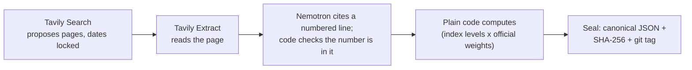

<!-- Generated by tools/sync_doc_numbers.py from docs/templates/README.md: edit the template, not this file. -->
# Shadow CPI

## The web rewrites history. Our agent catches it.

**An AI agent that searches the past without cheating: it writes its own Tavily searches inside a time lock it cannot
move, verifies every quote on the page, and seals India's inflation forecast before the government publishes it.**

**The leak, measured:** with no dates, 9 of 20 replay cases read a page that did not yet exist at
the cutoff (10 after a logged archive retry); inside the time lock, 0 of 20.

**Live app:** https://shadow-cpi.streamlit.app · **Demo video:** [TBD] · **Devpost:** [TBD]

**Reusable:** [`timelock/`](timelock/), time-locked search for any question, standard library only
([10-line example](#use-it-in-10-lines)).

## The problem

India's official CPI inflation figure arrives about 12 days after the month ends, so anyone forecasting
it from the web has to replay past months, and a replay that quietly reads a page published after its cutoff looks
better than it could ever be live (look-ahead bias). El Lahib et al. (2026, [arXiv 2602.00758](https://arxiv.org/abs/2602.00758))
found that on Google, for 71% of forecasting questions, at least one retrieved page contained major
post-cutoff leakage (41% revealed the answer directly). We found no
published audit of Tavily's date filters, so we measured it.

## Time-locked search leakage

The Tavily field report (app page "Tavily field report", built by `tools/build_field_report.py` into
[`results/field_report.json`](results/field_report.json)), summarised:

- **Date test (pilot, 20 replay cases, pre-registered in [`v2/DATE_TEST_PREREG.md`](v2/DATE_TEST_PREREG.md)).**
  With no dates, 9 of 20 cases leaked a page that did not yet exist at the cutoff
  (10 of 20 after a logged retry of the 11 archive lookups that had failed).
  With `start_date`/`end_date` plus `filter_by_published_date`: 0 of 20
  (0 of 20 after the retry). A leak counts only when the Wayback Machine confirms it.
- **Finance check (exploratory, 14 RBI decisions and company results, [`v2/FINANCE_PREREG.md`](v2/FINANCE_PREREG.md)).**
  The day-before search with no dates leaked the outcome for 2 of 14 events
  (10 of 14 after the logged archive retry); with dates and the filter,
  0 of 14. 0 of 14 filtered searches returned a result dated after the cutoff; an independent
  reviewer found 1 page whose current version leaks the outcome
  ([`results/timelock34_second_review.json`](results/timelock34_second_review.json)).
- **Check P, full page (exploratory, [`results/leakcheck_full_page.md`](results/leakcheck_full_page.md)).** Of
  132 pages that passed the date lock (Tavily's filter, or our own date check), 1 described an event
  after the cutoff. 71 pages held a later date somewhere in the text, but mostly as page furniture:
  43 in date bars, sidebars and related links, 21 benign, 6 unclear.
- **The cost of strictness: valid evidence lost.** In the date test, the filter dropped 12 of
  40 pieces of valid evidence, and our extra page-date check lost 27.
  Check E (exploratory, `exact_match`, [`results/leakcheck_exact_match.md`](results/leakcheck_exact_match.md)): the
  dated search re-found 25 of 40 verified quotes and missed 8 that the undated search
  found. Those are filter misses, not back-dating: 0 of 8 have a Tavily
  `published_date` after the cutoff (6 on or before it, 2 undated).
- **Receipt.** Credits and latency per setting are in the table; every call is in the flight recorder and the
  credit ledger.

| Check | Setting | Leaked, before retry | Leaked, after the logged archive retry | Valid evidence kept (before retry) | Credits per call | Median latency |
|---|---|---|---|---|---|---|
| Date test (20 replay cases) | no dates | 9 of 20 | 10 of 20 | 6 of 40 | 1.00 | 3.8 s |
| Date test (20 replay cases) | start_date + end_date | 0 of 20 | 0 of 20 | 21 of 40 | 1.00 | 3.4 s |
| Date test (20 replay cases) | + filter_by_published_date | 0 of 20 | 0 of 20 | 28 of 40 | 1.00 | 3.5 s |
| Date test (20 replay cases) | + our page check | 0 of 20 | 0 of 20 | 13 of 40 | 0.94 | 3.2 s |
| Finance check (14 scheduled events) | no dates | 2 of 14 | 10 of 14 | 1 of 11 | 1.00 | 3.2 s |
| Finance check (14 scheduled events) | start_date + end_date + filter_by_published_date | 0 of 14 | 0 of 14 | 10 of 11 | 1.00 | 1.4 s |
| Check P: full-page date check | start_date + end_date + filter_by_published_date (date test, arm C) | 0 of 47 | — | — | 0.00 | — |
| Check P: full-page date check | start_date + end_date + filter_by_published_date (finance check, arm D) | 1 of 65 | — | — | 1.00 | — |
| Check P: full-page date check | start_date + end_date + our date checks (v2 verified evidence, no filter) | 0 of 20 | — | — | n/a | — |
| Check E: exact_match back-dating | exact_match + end_date + filter_by_published_date, vs the same search undated | — | — | 25 of 40 | 1.00 | 1.7 s |

Small samples: every rate in the field report carries a Wilson interval (95%).

## Let the model program its filters, inside a time lock it cannot move

Tavily's dynamic filtering lets a model choose its own search fields. We built on that idea and tested it on
29 known retail price changes in Jan–Sep 2026 (pre-registered in
[`v2/PREREGISTRATION.md`](v2/PREREGISTRATION.md); [`results/v2_ablation.md`](results/v2_ablation.md)):

| Arm | Who writes the search | Known changes found |
|---|---|---|
| A | code, fixed templates | 6 of 29 |
| B | Nemotron Super (English, Hindi) | 2 of 29 |
| C | Nemotron Super (7 languages: English, Hindi and regional) | 2 of 29 |
| T | Tavily `auto_parameters`, no dates | 0 of 29 |
| H (exploratory, added after scoring) | templates + model-chosen fields | 4 of 29 (3 vs A's 6 on the 8 months H completed) |
| T+dates (exploratory, added after scoring) | `auto_parameters` + our dates | 2 of 29 (6 of 9 months complete) |

- **The fields were always valid.** Every field the model wrote was a proper Tavily parameter, dates included:
  189 of 189 searches in arms B and C, 468 of 468 in arm H.
- **Fixed templates still found more.** The likely cause is source choice: arm H differed from arm A only in
  `include_domains` (117 searches) and `language` (82).
- **`auto_parameters` with no dates assumes "now".** On 72 searches about past months it picked recent
  time ranges, and 620 of 659 results were from October 2026. With our dates added,
  532 of 532 dated results fell inside the window.

So the time lock lives in code: the model may choose the query, topic, domains and language; code owns the dates.

## How it works



1. **Tavily Search proposes.** Every search carries `start_date`/`end_date` and `filter_by_published_date`; code
   re-checks each result's date and drops anything after the cutoff.
2. **Tavily Extract verifies.** A snippet is a pointer, not evidence. Extract reads the page; Nemotron points to a
   numbered line; code copies that exact line and checks the number is in it. A model never writes a quote.
3. **Plain code computes.** Index levels combined with MoSPI's official weights, year-on-year last. A model never
   picks a number, a range or a weight.
4. **The seal.** Canonical JSON, its `SHA-256`, and a git tag, before MoSPI publishes.

**NVIDIA Nemotron on Nebius Token Factory.** Two models, one OpenAI-compatible endpoint
([`shadow_cpi/nemotron.py`](shadow_cpi/nemotron.py)); calls from the flight recorder
([`results/app/flight_recorder.jsonl`](results/app/flight_recorder.jsonl)):

| Model (Token Factory ID) | Job | Calls sent (including cache hits) |
|---|---|---|
| Nemotron Nano, `nvidia/NVIDIA-Nemotron-3-Nano-30B-A3B` | Gatekeeper: "does this page state an Indian price or price change?" (yes/no); English glosses of non-English quotes, for display only | 622 (4,829) |
| Nemotron Super, `nvidia/nemotron-3-super-120b-a12b` | Reads pages and cites the line for each price and price change; writes the search fields in arms B, C and H | 719 (5,177) |

Where Token Factory helped: JSON-schema output worked on the opening call, so every model answer is parsed, not
guessed; both model sizes sit behind the same endpoint, so the cheap gatekeeper and the careful reader are a
config change apart ([`config/models.json`](config/models.json)); and citing line numbers instead of copying text
made Hindi pages work. Details: [`FEEDBACK_NOTES.md`](FEEDBACK_NOTES.md).

## The product

- **The October 2026 nowcast.** To be sealed on 29 Oct (tag `seal-2026-10`); not sealed as of 27 Oct 2026; MoSPI publishes on 12 Nov at 4 pm
  IST. Anyone can check the seal: download `sealed/2026-10.json` at tag `seal-2026-10`, recompute its `SHA-256`, and
  compare it with `sealed/2026-10.sha256` ([`verify.md`](verify.md)). After the release, the Archive page shows the
  miss and whether the official figure was inside the range.
- **Price Shock Radar** (exploratory, report only; app page "October radar"): announced retail price changes taking
  effect this month, found with Tavily before MoSPI publishes. So far 1 event verified,
  0 corroborated, 52 of a 150-credit cap. It never changes the sealed call.
- **Live build** with **Replay a saved run**: watch the number build one verified card at a time. Replays make no
  API call and cost no credits.
- **Chain of custody:** from any number to its quote, page, page date, Tavily request ID, response hash and seal.
- **`as_of(day)`** ([`v2/asof.py`](v2/asof.py), app page "As of a date"): the nowcast and evidence as known on a
  past day; a test proves nothing found later can appear.

## Reuse it

### Use it in 10 lines

[`timelock/`](timelock/) needs no part of the CPI pipeline and no package outside the Python standard library.
`timelocked_search(client, query, cutoff, **tavily_kwargs)` sends `start_date`/`end_date` and
`filter_by_published_date=true`, refuses an `end_date` after the cutoff (or `time_range`, `days`,
`auto_parameters`, or the filter switched off) before any call, and returns Tavily's results, each with
`published_date`, `page_date` (when the page text was extracted), `status` (`safe` / `date_flag` / `leak`),
`request_id` and `response_sha256`. A result dated after the cutoff is a `leak` even if Tavily's filter let it through.

```python
import sys
from pathlib import Path

from timelock import Replay, TavilyHTTP, timelocked_search

saved = Path(__file__).resolve().parent.parent / "tests/fixtures/timelock/rbi_2026-10-06_locked.json"
client = TavilyHTTP() if "--live" in sys.argv else Replay(saved)          # live costs 1 Tavily credit
results = timelocked_search(client, "RBI monetary policy repo rate decision October 2026", cutoff="2026-10-06",
                            topic="news", search_depth="basic", max_results=5, include_published_date=True)
for r in results:
    print(r["status"], r["published_date"], r["url"])
print(results.counts, results.request_id, results.response_sha256[:12])
```

```bash
python -m examples.timelock_rbi                              # offline: a saved Tavily response, 0 credits
TAVILY_API_KEY=... python -m examples.timelock_rbi --live    # live
```

Offline it replays a real saved response (`tests/fixtures/timelock/`, request ID and hash checked in
[`tests/test_timelock.py`](tests/test_timelock.py)); `Replay` refuses any other request. Any client with
`.search(query, **kwargs) -> dict` works, including tavily-python's `TavilyClient`.

- **MCP server** [`mcp/`](mcp/README.md): `timelocked_search` as a tool for Claude Code, Claude Desktop or any MCP
  client; results after the cutoff come back as domain and date only, never their text or URL.
- **Benchmark** [`benchmarks/timelock34/`](benchmarks/timelock34/DATASHEET.md): the 20 date-test and
  14 finance replay cases with every result URL labelled (Wayback-confirmed leak, date flag, unknown) and a
  scorer for any search function (leak rate with Wilson intervals, valid evidence kept). Labels under CC BY.
- **`shadow_cpi/pit`** ([`shadow_cpi/pit/README.md`](shadow_cpi/pit/README.md)): the pipeline's wrapper around
  `timelock/`, adding the Flight Recorder and a month-start window.
- **Agent skill** [`skills/time-locked-search/SKILL.md`](skills/time-locked-search/SKILL.md): the same rules for any
  agent that searches the past.

### For research teams

Designed for research teams that need web evidence without look-ahead bias (event studies, backtests, forecast
evaluation); not adopted by any team yet. Exports (`python tools/export.py`, columns in
[`docs/exports_schema.md`](docs/exports_schema.md)), `as_of()`, the seal checks and the leak checker
([`timelock/check.py`](timelock/check.py), example in
[`examples/leakcheck_example.py`](examples/leakcheck_example.py)). Research tool, not investment advice.

## Scoreboard

Jan–Sep 2026 replay, rules frozen before scoring ([`results/score_lock.json`](results/score_lock.json),
[`results/scoreboard.md`](results/scoreboard.md)); mean absolute miss in percentage points:

| Method | Mean miss |
|---|---|
| Shadow CPI v1 (replay) | **0.194** |
| Trend only | 0.212 |
| Repeat last month's rate | 0.468 |

- On the 6 months with an economists' poll: Shadow CPI 0.150, the poll 0.148. About a tie.
- The 80% range held the official figure in 5 of 9 months, below its target.
- Shadow CPI v2 was not better: 0.206 ([`results/v2_score_lock.json`](results/v2_score_lock.json)).

## What we found about Tavily

Written as bug reports in [`docs/tavily_bug_reports.md`](docs/tavily_bug_reports.md) (built from
[`results/bug_reports.json`](results/bug_reports.json)):

- **`auto_parameters` ignores time-locked intent.** With no dates it picks a recent `time_range`: 620 of
  659 results from October 2026 on 72 searches about past months.
- **`published_date` can be later than the page's own date:** 4 of 42 distinct date-test pages.
- **Undated pages are dropped by the filter.** With no dates, 8 of 60
  results were undated; with the filter, 0. Some valid evidence is undated, so strictness has a
  cost (above).
- **Research has no date window.** The Research endpoint takes no `start_date`/`end_date`, so it stays out of
  time-locked work (checked in the API reference on 26 Oct; not measured).
- **Map returned nothing on Indian official sites,** silently: 5 of 5 sites
  on our official crawl list (state electricity regulators, IOCL, Amul) and 3 of 7 dairy sites, with no error or `failed_results`.
- **Scanned PDFs extract only the letterhead.** A dairy's rate-list PDF came back as its letterhead; the rates are an
  image.

## Honest limits

- Coverage: 14%–21% of the CPI basket is measured each month; the rest is assumed to follow its trend.
- Recall: the winning search arm found 6 of 29 known price changes.
- Small samples: pilot and exploratory checks of tens of cases, reported with Wilson intervals; exploratory results
  are labelled and changed no scored verdict.
- Tavily request IDs and response hashes were logged only for the later arms (C, T, T+dates, H and the radar);
  earlier runs say "not logged" ([`results/custody.json`](results/custody.json)).
- Direct, non-Tavily sources, each logged: the MoSPI API (official indices and weights), the Department of Consumer
  Affairs (DoCA) daily food prices (downloaded by hand from behind a CAPTCHA), and Wayback Machine lookups (date test
  only).
- Quote check by hand of the 12 audited events: 10 verbatim, 1 paywalled,
  1 not checked ([`audit/quote_check.md`](audit/quote_check.md)).
- We built a value-of-information score to rank searches; it rated almost every search as worthless, so we dropped it
  rather than tune it.
- A Hindi substring match ('rail' inside 'domestic') turned a Jharkhand power tariff into a 'Bihar rail' event.
  Our manual check caught it; the fix (whole-word matching, state from the page) removed the event, so the October
  radar has 1 event. Logged as Amendments `R2`–`R3`, with before and after
  ([`v2/RADAR_PREREG.md`](v2/RADAR_PREREG.md)).

More: [`docs/honest_limits.md`](docs/honest_limits.md), [`docs/frozen_rules.md`](docs/frozen_rules.md),
[`docs/after_scoring_changes.md`](docs/after_scoring_changes.md).

## Run it locally

```bash
pip install -r requirements-app.txt
```
```bash
streamlit run app.py
```

The app reads the committed results files, so it needs no keys. "Run live" stays off unless `RUN_LIVE_ENABLED` is set
and both keys (`SCPI_TAVILY_API_KEY`, `SCPI_NEBIUS_API_KEY`) are in the environment. Tests (no keys, no credits):

```bash
python -m pytest -q
```

To run the pipeline, copy `.env.example` to `.env`, add the two keys, and start with `python checks.py`. Deployment:
[`docs/deploy.md`](docs/deploy.md). Every number in this README is filled from the results files by
`python tools/sync_doc_numbers.py` (template: [`docs/templates/README.md`](docs/templates/README.md)).

Tavily usage so far (as of 27 Oct 2026, [`results/tavily_report_card.md`](results/tavily_report_card.md)):
2,028 calls sent, 1,975 credits used (a 1,000-credit monthly plan plus 3,125
add-on credits), 79% of dated search results inside the requested window, median latency
4.0 s.

## Licence, team, and when it was built

MIT ([`LICENSE`](LICENSE)). Built for the Nebius × NVIDIA Global AI Hackathon.

Team: [TBD]

Nothing in Shadow CPI existed before 26 Aug: the repository's earliest commit is dated 20 Oct 2026.
