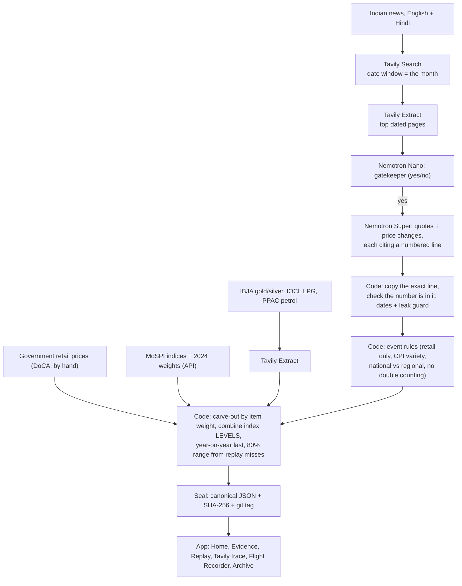

# Shadow CPI

**Shadow CPI predicts India's official CPI inflation before it's published, from live web evidence, with every
number cited, and seals each call in public before release.**

**Live app:** https://shadow-cpi.streamlit.app · **Demo video:** [TBD] · **Devpost:** [TBD]

**Result.** Jan–Sep 2026 replay: Shadow CPI missed by 0.194 percentage points on average; on the 6 months with an
economists' poll, 0.150 vs the poll's 0.148 (about a tie). ([`results/score_lock.json`](results/score_lock.json))

**Independent audit.** 12 events checked by hand: 5 correct, 3 partly, 3 wrong, 1 unclear; 9 confirmed by a second
source. Four general bug fixes followed, logged with scores before and after.
([`audit/event_audit.md`](audit/event_audit.md), [`docs/after_scoring_changes.md`](docs/after_scoring_changes.md))

**Recall.** Of 29 known retail price changes in Jan–Sep 2026, the pipeline found 9 directly, and 14 including the
official price series it reads (IOCL LPG, PPAC petrol). ([`audit/missed_events.md`](audit/missed_events.md))

## How NVIDIA Nemotron and Nebius Token Factory are used

Nemotron only **extracts**: it points to a numbered line on a page, code copies that exact line and checks the number
is in it. A model never writes a quote, never picks a number and never picks a weight.

| Model ID (Token Factory) | Job | Calls sent |
|---|---|---|
| `nvidia/NVIDIA-Nemotron-3-Nano-30B-A3B` | Gatekeeper: "does this page state an Indian price or an announced price change?" (yes/no) | 622 |
| `nvidia/nemotron-3-super-120b-a12b` | Reads a page and lists price quotes and price changes, each citing a numbered line; reads the skeptic's counter-search snippets | 719 |
| `nvidia/Nemotron-3-Ultra-550b-a55b` | Configured in `config/models.json`, not used: the reporter brief is written by code | 0 |

Calls sent = uncached calls in the flight recorder ([`results/app/flight_recorder.jsonl`](results/app/flight_recorder.jsonl)).
Token Factory is called at
[`shadow_cpi/nemotron.py` line 69](https://github.com/bhavikjain026/shadow-cpi/blob/9345bdc034f066490c8679bff18d66f296bcbe3a/shadow_cpi/nemotron.py#L69)
(`POST /chat/completions` with a JSON schema; plain-JSON fallback on line 78), base URL in
[`shadow_cpi/settings.py` line 8](https://github.com/bhavikjain026/shadow-cpi/blob/9345bdc034f066490c8679bff18d66f296bcbe3a/shadow_cpi/settings.py#L8).

## How Tavily is used

Every web page the nowcast uses comes in through Tavily, and every call is cached and logged in the flight recorder.
All requests go through one function,
[`shadow_cpi/tavily.py` line 26](https://github.com/bhavikjain026/shadow-cpi/blob/9345bdc034f066490c8679bff18d66f296bcbe3a/shadow_cpi/tavily.py#L26).

| Endpoint | Job | Where |
|---|---|---|
| **Search**, dates locked | News search with `start_date`/`end_date` = the target month (plus 10 days before, for announcements), English and Hindi news preferred; code re-checks each page's date and drops pages that state the official figure | [`evidence.py` L258](https://github.com/bhavikjain026/shadow-cpi/blob/9345bdc034f066490c8679bff18d66f296bcbe3a/shadow_cpi/evidence.py#L258) |
| **Extract** | Reads the top dated pages with query-focused chunks; reads IBJA's daily gold/silver report PDFs, IOCL's LPG price list and PPAC's petrol prices | [`evidence.py` L280](https://github.com/bhavikjain026/shadow-cpi/blob/9345bdc034f066490c8679bff18d66f296bcbe3a/shadow_cpi/evidence.py#L280), [L522](https://github.com/bhavikjain026/shadow-cpi/blob/9345bdc034f066490c8679bff18d66f296bcbe3a/shadow_cpi/evidence.py#L522) |
| **Map + Crawl** (attempts) | Looked for price circulars and tariff orders on 5 official sites and 6 dairy sites. Map returned nothing on the government and PSU sites; reported, not used | [`tools/prompt_t.py` L65](https://github.com/bhavikjain026/shadow-cpi/blob/9345bdc034f066490c8679bff18d66f296bcbe3a/tools/prompt_t.py#L65) |
| **Search** (evidence chase) | Up to 2 follow-up searches per verified event: the same change elsewhere, and the official notice | [`tools/prompt_t.py` L316](https://github.com/bhavikjain026/shadow-cpi/blob/9345bdc034f066490c8679bff18d66f296bcbe3a/tools/prompt_t.py#L316) |
| **GET /usage** (guard) | Before every live run in the app: refuse below 150 credits left, or if the check fails | [`tavily.py` L70](https://github.com/bhavikjain026/shadow-cpi/blob/9345bdc034f066490c8679bff18d66f296bcbe3a/shadow_cpi/tavily.py#L70), [`live_run.py` L68](https://github.com/bhavikjain026/shadow-cpi/blob/9345bdc034f066490c8679bff18d66f296bcbe3a/shadow_cpi/live_run.py#L68) |

Measured in [`results/tavily_report_card.md`](results/tavily_report_card.md): 788 Tavily calls sent, 694 of 1,500
credits used, 77% of dated search results inside the requested window. Two sources do not come through Tavily, by
design: MoSPI's official indices (a JSON API) and the government's daily food prices (behind a CAPTCHA, downloaded by
hand). Both are logged.

---

## Pipeline



More detail, including every Tavily setting: [`docs/pipeline.md`](docs/pipeline.md).

## Run it locally

```bash
pip install -r requirements-app.txt
```
```bash
streamlit run app.py
```

The app reads the committed results files, so it needs no keys. The "Run live" button stays off unless
`RUN_LIVE_ENABLED` is set and both keys (`SCPI_TAVILY_API_KEY`, `SCPI_NEBIUS_API_KEY`) are in the environment.
Tests (no keys, no credits):

```bash
python -m pytest -q
```

To run the pipeline itself, copy `.env.example` to `.env`, add the two keys, and start with `python checks.py`.
Deployment: [`docs/deploy.md`](docs/deploy.md).

## The seal, and how to check it

Each month's call is written as canonical JSON with its SHA-256 fingerprint and tagged in git (`seal-2026-10`)
before MoSPI publishes. Anyone can download the file at the tag and recompute the fingerprint:
[`verify.md`](verify.md). After the release, the Archive page shows the miss and whether the official figure was
inside the range.

## Honest limits

Nine test months is a small sample; the 80% range held the official figure in only 5 of 9 replay months; about
14–21% of the basket is measured each month and the rest is carried on trend; replays search today's web with date
filters. All of it, plainly: [`docs/honest_limits.md`](docs/honest_limits.md). Rules and every change after
scoring: [`docs/frozen_rules.md`](docs/frozen_rules.md), [`docs/after_scoring_changes.md`](docs/after_scoring_changes.md).

## Licence

MIT ([`LICENSE`](LICENSE)). Built for the Nebius × NVIDIA Global AI Hackathon, 2026.
