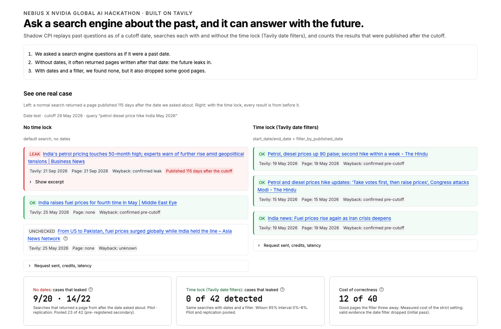

<!-- Generated by tools/sync_doc_numbers.py from docs/templates/gallery.md: edit the template, not this file. -->
# Gallery

Four images for the Devpost gallery, all `1600` px wide: the two diagrams are `1600x900`; the two app shots are
cropped to their content, so they are shorter. The two app shots and both diagrams are drawn by
`python tools/build_gallery.py --app <app URL>`; these captions are filled from the results files by
`python tools/sync_doc_numbers.py` (edit `docs/templates/gallery.md`, not this file).

## The opening screen

**Ask a search engine about the past, and it can answer with the future.** The app's opening screen. Date test (pilot, 20 past
cases, the pre-registered initial pass): with no dates, 9 of 20 cases kept a confirmed leak, a
page dated after the cutoff with no archive copy on or before it (Wilson 95% 26–66%;
10 of 20 after retrying the 11 archive lookups that had failed); with
`start_date`/`end_date` and `filter_by_published_date`, 0 of 20 detected (0–16%; the dates
alone already gave 0 of 20 detected). The cost: the
filter dropped 12 of 40 pieces of valid evidence (initial pass). Replication
(pre-registered, 22 new cases, initial pass): no dates 14 of 22, dates + filter
0 of 22 detected (0–15%); pilot and replication together, same rule: 0 of
42 detected with dates + filter (0–8%). Three cards (no dates, time lock (Tavily date filters),
cost of correctness), with the dot-and-interval chart of the same counts just below. App page: Leak demo (home). Source: `results/leak_demo.json`,
`results/field_report.json`, `results/replication.json`.

## The four-arm table

**Who should write the search?** On 29 known price changes, fixed code templates (arm A) found
6; Nemotron-written fields (arms B and C) 2 and 2; Tavily
`auto_parameters` (arm T) 0. The model's fields were always valid (189 of
189), but templates found more, so the model may choose words and sources while code owns the dates.
Pre-registered. App page: Field Report. Source: `results/field_report.json`, `results/v2_ablation.json`.

## R196: a search date does not freeze the page

**R196**, a TCS results preview: Tavily dated it 7 Jul, the cutoff was 8 Jul,
and the page was edited 9 Jul with a link to the actual result, so Extract today returns the edited page.
`extract_as_of` looks for an archived copy from on or before the cutoff; the earliest capture is 9 Jul, so it
returns **no as-of copy** instead of today's text. A demo, n=1, not a measurement (1 Tavily credit). Source:
`results/asof_demo_r196.json`.

## From search to seal

**The pipeline.** Tavily Search proposes dated pages; the time lock sends the dates and code re-checks each one;
Extract returns the page as numbered lines; the quote-check box reads "Nemotron on Nebius Token Factory: Nano screens
the page, Super cites the exact line", with "code checks the number on the page" under it; the
forecast is sealed with its SHA-256 and a git tag before the official release. Details: `docs/pipeline.md`.
