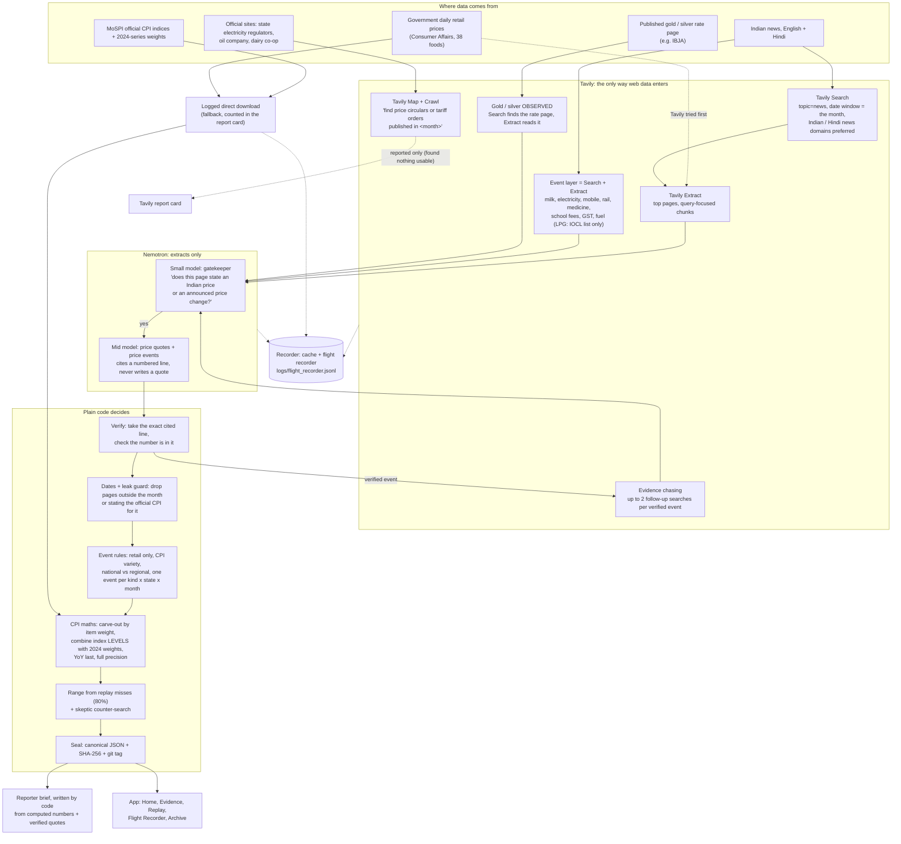

# Shadow CPI pipeline

Who does what:
- **Tavily** brings in every piece of web data. Logged direct downloads are a counted fallback.
- **Nemotron** (on Nebius Token Factory) only *extracts* facts and cites a numbered line: Nano 30B as a yes/no gatekeeper, Super 120B for quotes and price changes.
- **Plain code** decides everything else: the model returns a line number, code copies that line from the Extract output and checks the number is in it; code matches prices, does all the arithmetic, and seals the result.

## Which Tavily endpoint does which job

| Job | Tavily endpoint | Notes |
| --- | --- | --- |
| Price quotes (March 2026 test; other replay months skip them to save credits) | **Search** (`topic="news"`, `search_depth="basic"`, `max_results=8`, start/end = the month, Indian/Hindi news domains with `include_domains_mode="prefer"`, `mospi.gov.in` excluded) then **Extract** (top 6, `query=…`, `chunks_per_source=5`) | English + Hindi (Devanagari) queries |
| Event layer: announced price changes with effective dates | **Search** + **Extract**; page dates from the last 10 days of the previous month through the month | Applied only if the effective date is inside the month, pro-rated by days. Milk and electricity in English + Hindi; other kinds English only; no LPG events since Amendment 1 (LPG comes from IOCL's list) |
| Gold and silver, observed daily | **Extract** reads IBJA's daily bullion-report PDFs (each lists 4 trading days) | Never left on trend |
| LPG and petrol, observed | **Extract** reads IOCL's domestic LPG price list and PPAC's Delhi petrol prices | Petrol history found only from mid-May 2026 |
| Official circulars and tariff orders (attempted) | **Map** then **Crawl** (`instructions=…`, `select_paths`, `extract_depth="basic"`, `limit` ≤ 15, `allow_external=False`) | 5 official sites and 6 dairy sites tried for October 2026; Map returned nothing on the government and PSU sites, so results are reported in `results/tavily_report_card.md`, not used |
| Evidence chasing | **Search** (≤ 2 follow-ups per verified event) | Report only: 5 of 12 replay events had a confirming result from another site (`results/tavily_report_card.md`) |
| Government daily retail prices (spine) | none: downloaded by hand from behind a CAPTCHA | The site blocks Tavily and its report menu has a CAPTCHA (see honest_limits.md) |
| Economists' poll articles | **Search** | Dated original article only |
| MoSPI official indices | none: logged direct download from MoSPI's public API | A paged JSON API Tavily cannot call |

Every call, from Tavily, Nebius or a direct download, goes through the Recorder. The Recorder caches each response and logs one line with the time, parameters, results, credits, latency and parent call.
