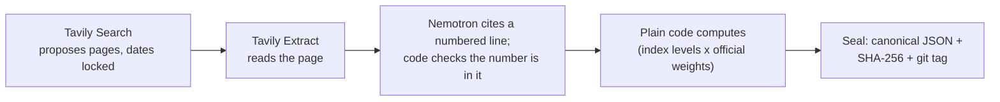

# Shadow CPI

## The web rewrites history. Our agent catches it.

**An AI agent that searches the past without cheating: it writes its own Tavily searches inside a time lock it cannot
move, verifies every quote on the page, and seals India's inflation forecast before the government publishes it.**

**Live app:** https://shadow-cpi.streamlit.app · **Demo video:** [TBD] · **Devpost:** [TBD]

## The problem

India's official CPI inflation figure arrives about {{release_lag}} days after the month ends, so anyone forecasting
it from the web has to replay past months, and a replay that quietly reads a page published after its cutoff looks
better than it could ever be live (look-ahead bias). El Lahib et al. ({{lahib_year}}, [arXiv {{lahib_arxiv}}](https://arxiv.org/abs/{{lahib_arxiv}}))
found that on Google, for {{lahib_pct}} of forecasting questions, at least one retrieved page contained major
post-cutoff leakage ({{lahib_revealed_pct}} revealed the answer directly). We found no
published audit of Tavily's date filters, so we measured it.

## Time-locked search leakage

The Tavily field report (app page "Tavily field report", built by `tools/build_field_report.py` into
[`results/field_report.json`](results/field_report.json)), summarised:

- **Date test (pilot, {{dt_cases}} replay cases, pre-registered in [`v2/DATE_TEST_PREREG.md`](v2/DATE_TEST_PREREG.md)).**
  With no dates, {{dt_nodates}} of {{dt_cases}} cases leaked a page that did not yet exist at the cutoff
  ({{dt_nodates_retry}} of {{dt_cases}} after a logged retry of the {{dt_retry_urls}} archive lookups that had failed).
  With `start_date`/`end_date` plus `filter_by_published_date`: {{dt_dated}} of {{dt_cases}}
  ({{dt_dated_retry}} of {{dt_cases}} after the retry). A leak counts only when the Wayback Machine confirms it.
- **Finance check (exploratory, {{fin_events}} RBI decisions and company results, [`v2/FINANCE_PREREG.md`](v2/FINANCE_PREREG.md)).**
  The day-before search with no dates leaked the outcome for {{fin_nodates}} of {{fin_events}} events
  ({{fin_nodates_retry}} of {{fin_events}} after the logged archive retry); with dates and the filter,
  {{fin_dated}} of {{fin_events}}.
- **Check P, full page (exploratory, [`results/leakcheck_full_page.md`](results/leakcheck_full_page.md)).** Of
  {{p_pages}} pages that passed the date lock (Tavily's filter, or our own date check), {{p_later}} described an event
  after the cutoff. {{p_flagged}} pages held a later date somewhere in the text, but mostly as page furniture:
  {{p_furniture}} in date bars, sidebars and related links, {{p_benign}} benign, {{p_unclear}} unclear.
- **The cost of strictness: valid evidence lost.** In the date test, the filter dropped {{dt_lost_filter}} of
  {{dt_valid_total}} pieces of valid evidence, and our extra page-date check lost {{dt_lost_pagecheck}}.
  Check E (exploratory, `exact_match`, [`results/leakcheck_exact_match.md`](results/leakcheck_exact_match.md)): the
  dated search re-found {{e_found}} of {{e_quotes}} verified quotes and missed {{e_missed}} that the undated search
  found. Those are filter misses, not back-dating: {{e_missed_later}} of {{e_missed}} have a Tavily
  `published_date` after the cutoff ({{e_missed_earlier}} on or before it, {{e_missed_undated}} undated).
- **Receipt.** Credits and latency per setting are in the table; every call is in the flight recorder and the
  credit ledger.

{{leakage_table}}

Small samples: every rate in the field report carries a Wilson interval ({{wilson}}).

## Let the model program its filters, inside a time lock it cannot move

Tavily's dynamic filtering lets a model choose its own search fields. We built on that idea and tested it on
{{known_changes}} known retail price changes in {{replay_span}} (pre-registered in
[`v2/PREREGISTRATION.md`](v2/PREREGISTRATION.md); [`results/v2_ablation.md`](results/v2_ablation.md)):

| Arm | Who writes the search | Known changes found |
|---|---|---|
| A | code, fixed templates | {{arm_a_recall}} of {{known_changes}} |
| B | Nemotron Super (English, Hindi) | {{arm_b_recall}} of {{known_changes}} |
| C | Nemotron Super ({{arm_c_langs}} languages: English, Hindi and regional) | {{arm_c_recall}} of {{known_changes}} |
| T | Tavily `auto_parameters`, no dates | {{arm_t_recall}} of {{known_changes}} |
| H (exploratory, added after scoring) | templates + model-chosen fields | {{arm_h_recall}} of {{known_changes}} ({{arm_h_l4l}} vs A's {{arm_h_l4l_a}} on the {{arm_h_l4l_months}} months H completed) |
| T+dates (exploratory, added after scoring) | `auto_parameters` + our dates | {{arm_td_recall}} of {{known_changes}} ({{arm_td_complete}} of {{arm_td_months}} months complete) |

- **The fields were always valid.** Every field the model wrote was a proper Tavily parameter, dates included:
  {{bc_fields_valid}} of {{bc_fields}} searches in arms B and C, {{arm_h_fields_valid}} of {{arm_h_fields}} in arm H.
- **Fixed templates still found more.** The likely cause is source choice: arm H differed from arm A only in
  `include_domains` ({{arm_h_diff_domains}} searches) and `language` ({{arm_h_diff_language}}).
- **`auto_parameters` with no dates assumes "now".** On {{auto_searches}} searches about past months it picked recent
  time ranges, and {{auto_oct}} of {{auto_results}} results were from {{live_month}}. With our dates added,
  {{autod_inside}} of {{autod_dated}} dated results fell inside the window.

So the time lock lives in code: the model may choose the query, topic, domains and language; code owns the dates.

## How it works



1. **Tavily Search proposes.** Every search carries `start_date`/`end_date` and `filter_by_published_date`; code
   re-checks each result's date and drops anything after the cutoff.
2. **Tavily Extract verifies.** A snippet is a pointer, not evidence. Extract reads the page; Nemotron points to a
   numbered line; code copies that exact line and checks the number is in it. A model never writes a quote.
3. **Plain code computes.** Index levels combined with MoSPI's official weights, year-on-year last. A model never
   picks a number, a range or a weight.
4. **The seal.** Canonical JSON, its `SHA-256`, and a git tag, before MoSPI publishes.

**NVIDIA Nemotron on Nebius Token Factory.** Two models, one OpenAI-compatible endpoint
([`shadow_cpi/nemotron.py`](shadow_cpi/nemotron.py)); calls from the flight recorder
([`results/app/flight_recorder.jsonl`](results/app/flight_recorder.jsonl)):

| Model (Token Factory ID) | Job | Calls sent (including cache hits) |
|---|---|---|
| Nemotron Nano, `nvidia/NVIDIA-Nemotron-3-Nano-30B-A3B` | Gatekeeper: "does this page state an Indian price or price change?" (yes/no); English glosses of non-English quotes, for display only | {{nano_sent}} ({{nano_total}}) |
| Nemotron Super, `nvidia/nemotron-3-super-120b-a12b` | Reads pages and cites the line for each price and price change; writes the search fields in arms B, C and H | {{super_sent}} ({{super_total}}) |

Where Token Factory helped: JSON-schema output worked on the opening call, so every model answer is parsed, not
guessed; both model sizes sit behind the same endpoint, so the cheap gatekeeper and the careful reader are a
config change apart ([`config/models.json`](config/models.json)); and citing line numbers instead of copying text
made Hindi pages work. Details: [`FEEDBACK_NOTES.md`](FEEDBACK_NOTES.md).

## The product

- **The {{live_month}} nowcast.** {{seal_status}}; MoSPI publishes on {{release_day}} at {{release_hour}}
  IST. Anyone can check the seal: download `sealed/2026-10.json` at tag `seal-2026-10`, recompute its `SHA-256`, and
  compare it with `sealed/2026-10.sha256` ([`verify.md`](verify.md)). After the release, the Archive page shows the
  miss and whether the official figure was inside the range.
- **Price Shock Radar** (exploratory, report only; app page "October radar"): announced retail price changes taking
  effect this month, found with Tavily before MoSPI publishes. So far {{radar_events_phrase}} verified,
  {{radar_corroborated}} corroborated, {{radar_spent}} of a {{radar_cap}}-credit cap. It never changes the sealed call.
- **Live build** with **Replay a saved run**: watch the number build one verified card at a time. Replays make no
  API call and cost no credits.
- **Chain of custody:** from any number to its quote, page, page date, Tavily request ID, response hash and seal.
- **`as_of(day)`** ([`v2/asof.py`](v2/asof.py), app page "As of a date"): the nowcast and evidence as known on a
  past day; a test proves nothing found later can appear.

## Reuse it

- **`shadow_cpi/pit`** ([`shadow_cpi/pit/README.md`](shadow_cpi/pit/README.md)): `pit_search(query, cutoff)` always
  sends the dates and the filter, refuses any parameter that would move the window, flags undated results, drops
  anything dated after the cutoff, and keeps Tavily's request ID and the response hash.
- **Agent skill** [`skills/time-locked-search/SKILL.md`](skills/time-locked-search/SKILL.md): the same rules for any
  agent that searches the past.

```python
from shadow_cpi.pit import pit_search

r = pit_search("RBI repo rate decision October 2026", cutoff="2026-10-06",
               topic="news", max_results=5,                   # the model may set these
               include_domains=["rbi.org.in", "livemint.com"])
r["kept"]       # dated on or before the cutoff: read the page before using it
r["flagged"]    # undated: not trusted
r["leaks"]      # dated after the cutoff: dropped
r["counts"], r["request_id"], r["response_sha256"], r["credits"]
# passing start_date, end_date, time_range, days or auto_parameters raises TimeLockError
```

### For research teams

Designed for research teams that need web evidence without look-ahead bias (event studies, backtests, forecast
evaluation); not adopted by any team yet. Exports (`python tools/export.py`, columns in
[`docs/exports_schema.md`](docs/exports_schema.md)), `as_of()`, the seal checks and the leak checker
([`shadow_cpi/leakcheck.py`](shadow_cpi/leakcheck.py), example in
[`examples/leakcheck_example.py`](examples/leakcheck_example.py)). Research tool, not investment advice.

## Scoreboard

{{replay_span}} replay, rules frozen before scoring ([`results/score_lock.json`](results/score_lock.json),
[`results/scoreboard.md`](results/scoreboard.md)); mean absolute miss in percentage points:

| Method | Mean miss |
|---|---|
| Shadow CPI v1 (replay) | **{{mae_c}}** |
| Trend only | {{mae_trend}} |
| Repeat last month's rate | {{mae_b1}} |

- On the {{poll_months}} months with an economists' poll: Shadow CPI {{mae_poll_c}}, the poll {{mae_poll}}. About a tie.
- The {{range_level}} range held the official figure in {{inside}} of {{months}} months, below its target.
- Shadow CPI v2 was not better: {{mae_v2}} ([`results/v2_score_lock.json`](results/v2_score_lock.json)).

## What we found about Tavily

Written as bug reports in [`docs/tavily_bug_reports.md`](docs/tavily_bug_reports.md) (built from
[`results/bug_reports.json`](results/bug_reports.json)):

- **`auto_parameters` ignores time-locked intent.** With no dates it picks a recent `time_range`: {{auto_oct}} of
  {{auto_results}} results from {{live_month}} on {{auto_searches}} searches about past months.
- **`published_date` can be later than the page's own date:** {{pd_later}} of {{pd_pages}} distinct date-test pages.
- **Undated pages are dropped by the filter.** With no dates, {{dt_undated_nodates}} of {{dt_results_nodates}}
  results were undated; with the filter, {{dt_undated_filter}}. Some valid evidence is undated, so strictness has a
  cost (above).
- **Research has no date window.** The Research endpoint takes no `start_date`/`end_date`, so it stays out of
  time-locked work (checked in the API reference on {{research_checked}}; not measured).
- **Map returned nothing on Indian official sites,** silently: {{map_official_empty}} of {{map_official}} sites
  on our official crawl list (state electricity regulators, IOCL, Amul) and {{map_dairy_empty}} of {{map_dairy}} dairy sites, with no error or `failed_results`.
- **Scanned PDFs extract only the letterhead.** A dairy's rate-list PDF came back as its letterhead; the rates are an
  image.

## Honest limits

- Coverage: {{cov_low}}–{{cov_high}} of the CPI basket is measured each month; the rest is assumed to follow its trend.
- Recall: the winning search arm found {{arm_a_recall}} of {{known_changes}} known price changes.
- Small samples: pilot and exploratory checks of tens of cases, reported with Wilson intervals; exploratory results
  are labelled and changed no scored verdict.
- Tavily request IDs and response hashes were logged only for the later arms (C, T, T+dates, H and the radar);
  earlier runs say "not logged" ([`results/custody.json`](results/custody.json)).
- Direct, non-Tavily sources, each logged: the MoSPI API (official indices and weights), the Department of Consumer
  Affairs (DoCA) daily food prices (downloaded by hand from behind a CAPTCHA), and Wayback Machine lookups (date test
  only).
- Quote check by hand of the {{q_events}} audited events: {{q_verbatim}} verbatim, {{q_paywalled}} paywalled,
  {{q_not_checked}} not checked ([`audit/quote_check.md`](audit/quote_check.md)).
- We built a value-of-information score to rank searches; it rated almost every search as worthless, so we dropped it
  rather than tune it.
- A Hindi substring match ('rail' inside 'domestic') turned a Jharkhand power tariff into a 'Bihar rail' event.
  Our manual check caught it; the fix (whole-word matching, state from the page) removed the event, so the October
  radar has {{radar_events_phrase}}. Logged as Amendments `R2`–`R3`, with before and after
  ([`v2/RADAR_PREREG.md`](v2/RADAR_PREREG.md)).

More: [`docs/honest_limits.md`](docs/honest_limits.md), [`docs/frozen_rules.md`](docs/frozen_rules.md),
[`docs/after_scoring_changes.md`](docs/after_scoring_changes.md).

## Run it locally

```bash
pip install -r requirements-app.txt
```
```bash
streamlit run app.py
```

The app reads the committed results files, so it needs no keys. "Run live" stays off unless `RUN_LIVE_ENABLED` is set
and both keys (`SCPI_TAVILY_API_KEY`, `SCPI_NEBIUS_API_KEY`) are in the environment. Tests (no keys, no credits):

```bash
python -m pytest -q
```

To run the pipeline, copy `.env.example` to `.env`, add the two keys, and start with `python checks.py`. Deployment:
[`docs/deploy.md`](docs/deploy.md). Every number in this README is filled from the results files by
`python tools/sync_doc_numbers.py` (template: [`docs/templates/README.md`](docs/templates/README.md)).

Tavily usage so far (as of {{as_of}}, [`results/tavily_report_card.md`](results/tavily_report_card.md)):
{{run_calls}} calls sent, {{run_credits}} credits used (a {{plan_limit}}-credit monthly plan plus {{addon_credits}}
add-on credits), {{run_inside_pct}} of dated search results inside the requested window, median latency
{{run_latency}}.

## Licence, team, and when it was built

MIT ([`LICENSE`](LICENSE)). Built for the Nebius × NVIDIA Global AI Hackathon.

Team: [TBD]

Nothing in Shadow CPI existed before {{hackathon_start}}: the repository's earliest commit is dated {{earliest_commit}}.
