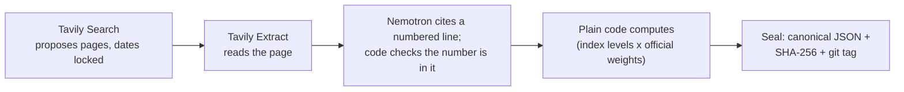

# Shadow CPI

## Can a search engine keep the past in the past? We measured Tavily's date controls.

**An AI agent that searches the past without cheating: it uses Tavily inside a time lock it cannot move, checks every
quote on its source page, and seals India's inflation forecast before the government publishes it.**

| Leaks, measured | No dates | Dates + filter |
|---|---|---|
| Date test ({{dt_cases}} cases) | **{{dt_nodates_retry}} of {{dt_cases}}** | **{{dt_dated_retry}} of {{dt_cases}}** (Wilson {{dt_dated_retry_w}}) |
| Finance check ({{fin_events}} cases, exploratory, different leak rule) | {{fin_nodates_retry}} of {{fin_events}} | {{fin_dated_retry}} of {{fin_events}} |

Separate rules; never added together. After the logged archive retry; initial pass in the footnote.

<details>
<summary>Footnote: what counts as a leak, and the initial pass</summary>

- **Dates + filter** means `start_date`/`end_date` plus `filter_by_published_date`; no dates means neither.
- **Date test** (pilot, replay cases; [`v2/DATE_TEST_PREREG.md`](v2/DATE_TEST_PREREG.md)). A case leaks when at least
  one result the search kept is a confirmed leak: "{{dt_leak_rule}}"
- **Finance check** (exploratory, Reserve Bank of India (RBI) decisions and company results;
  [`v2/FINANCE_PREREG.md`](v2/FINANCE_PREREG.md), as amended). A different rule, so its counts are reported apart:
  "{{fin_leak_rule}}"
- **After the logged archive retry.** The table counts follow a logged retry of the archive lookups that had failed.
  On the initial pass, {{rr_fin_failed}} finance-check archive lookups (and {{rr_dt_failed}} in the date test) failed
  for network reasons, so those pages could only be flagged, not confirmed; the retry recovered {{rr_recovered}},
  which is why the finance count rises from {{fin_nodates}} to {{fin_nodates_retry}} of {{fin_events}}. Wilson {{wilson}} intervals: date
  test no dates {{dt_nodates_retry_w}}, dates + filter {{dt_dated_retry_w}}; finance check no dates
  {{fin_nodates_retry_w}}, dates + filter {{fin_dated_retry_w}}.
- **Initial pass** (the pre-registered result, shown as sensitivity): date test {{dt_nodates}} of {{dt_cases}}
  ({{dt_nodates_w}}) with no dates and {{dt_dated}} of {{dt_cases}} ({{dt_dated_w}}) with dates + filter; finance
  check {{fin_nodates}} of {{fin_events}} and {{fin_dated}} of {{fin_events}}.

</details>

**The cost.** The filter dropped {{dt_lost_filter}} of the date test's {{dt_valid_total}} pieces of valid evidence
(initial pass).

**Search dates do not freeze page content.** Tavily dated `{{ex_row}}`, a {{ex_company}} results preview, {{ex_published}},
before its {{ex_cutoff}} cutoff; the page was updated on {{ex_updated}} with a link to the actual result, and Extract
returns the updated page ([details](#search-dates-do-not-freeze-page-content)).

**Reuse it:** [`timelock/`](timelock/) (time-locked search, standard library only,
[{{example_lines}}-line example](#use-it-in-{{example_lines}}-lines)) · [`mcp/`](mcp/README.md) (the same as an MCP
tool) · [`benchmarks/timelock34/`](benchmarks/timelock34/DATASHEET.md) (the labelled benchmark and scorer) · [](https://colab.research.google.com/github/bhavikjain026/shadow-cpi/blob/main/notebooks/reproduce_leak.ipynb) reproduce the leak with your own Tavily key ([`repro/`](repro/README.md) for the Tavily items).

**Live app:** https://shadow-cpi.streamlit.app · **Demo video:** [TBD] · **Devpost:** [TBD]

> **Required technologies**
>
> - **Nebius Token Factory**, endpoint host `{{nebius_host}}` (OpenAI-compatible; [`shadow_cpi/nemotron.py`](shadow_cpi/nemotron.py))
> - **NVIDIA Nemotron Nano**, `{{nano_id}}` (from {{switch_day}}: `{{nano_new}}`): yes/no gatekeeper ("does this page state an Indian price or price
>   change?") and display-only English glosses
> - **NVIDIA Nemotron Super**, `{{super_id}}` (from {{switch_day}}: `{{super_new}}`): reads the page and cites the line for each price and price change;
>   writes the search fields in arms B, C and H
> - Model roles: [`config/models.json`](config/models.json). Nebius retires the original IDs on {{switch_day}}; from then, calls use Nebius's recommended replacements (pre-registered on {{migration_registered}}).
> - **Tavily API** endpoints used: {{tavily_endpoints}} (and `/usage` for the balance)

## Time-locked search leakage

The Tavily field report (app page "Tavily field report", built by `tools/build_field_report.py` into
[`results/field_report.json`](results/field_report.json)), summarised. Each check has its own pre-registered leak
rule and its own count; date-test and finance counts are never added together.

- **Date test (pilot, {{dt_cases}} replay cases, [`v2/DATE_TEST_PREREG.md`](v2/DATE_TEST_PREREG.md)).** Rule quoted
  above. After the logged archive retry: no dates {{dt_nodates_retry}} of {{dt_cases}}, dates + filter
  {{dt_dated_retry}} of {{dt_cases}}; initial pass {{dt_nodates}} and {{dt_dated}}. Every case whose label changed
  after the retry ({{retry_changed}} of {{retry_cases}}, both checks), with the reason:
  [`docs/retry_reconciliation.md`](docs/retry_reconciliation.md).
- **Finance check (exploratory, {{fin_events}} Reserve Bank of India (RBI) decisions and company results,
  [`v2/FINANCE_PREREG.md`](v2/FINANCE_PREREG.md)).** Rule quoted above (it also needs the title or snippet to state
  the outcome). The day-before search with no dates leaked the outcome for {{fin_nodates_retry}} of {{fin_events}}
  events after the logged archive retry (Wilson {{wilson}} {{fin_nodates_retry_w}}; initial pass {{fin_nodates}}); with
  dates and the filter, {{fin_dated_retry}} of {{fin_events}} ({{fin_dated_retry_w}}; initial pass {{fin_dated}}).
- **Tasks and calls.** Each task sent one search per setting, so call counts equal task counts
  ({{dt_leak_calls_nodates}} of {{dt_calls_nodates}} date-test calls and {{fin_leak_calls_nodates}} of
  {{fin_calls_nodates}} finance calls with no dates leaked on the initial pass;
  [`results/date_field_test.json`](results/date_field_test.json),
  [`results/finance_lookahead.json`](results/finance_lookahead.json)).
- **Check P, full page (exploratory, [`results/leakcheck_full_page.md`](results/leakcheck_full_page.md)).** Of
  {{p_pages}} pages that passed the date lock (Tavily's filter, or our own date check), {{p_later}} described an event
  after the cutoff. {{p_flagged}} pages held a later date somewhere in the text, but mostly as page furniture:
  {{p_furniture}} in date bars, sidebars and related links, {{p_benign}} benign, {{p_unclear}} unclear.
- **Receipt.** Credits and latency per setting are in the table; every call is in the flight recorder and the
  credit ledger.

**Leak counts** (case level; after the logged archive retry is the main count, the initial pass is the sensitivity):

{{leak_count_table}}

**Valid evidence kept** (initial pass; each check has its own denominator):

{{evidence_kept_table}}

With our extra page-date check added to the filter, {{dt_lost_pagecheck}} of the date test's {{dt_valid_total}}
pieces of valid evidence were lost. Check E's misses are filter misses, not back-dating: {{e_missed_later}} of
{{e_missed}} have a Tavily `published_date` after the cutoff ({{e_missed_earlier}} on or before it,
{{e_missed_undated}} undated; [`results/leakcheck_exact_match.md`](results/leakcheck_exact_match.md)).

Small samples: every rate in the field report carries a Wilson interval ({{wilson}}).

## Search dates do not freeze page content

Tavily's date filter works on a page's date; Extract returns the page as it is when we call it. A page dated before
the cutoff can be updated after it, and the filter cannot see that. Example (from a separate, post-hoc AI-assisted
review (ChatGPT agent); {{sr_unclear}} of {{sr_rows}} rows stayed unclear): `{{ex_row}}`, a {{ex_company}} results
preview in the finance check, cutoff {{ex_cutoff}}. Tavily dated it {{ex_published}}, before the cutoff; the page
was updated on {{ex_updated}} with a link to the actual result. In the finance check, {{sr_fin_dated_after}} of
{{sr_fin_searches}} filtered searches returned a result dated after the cutoff, and that review still found
{{sr_fin_reviewer_leaks}} page whose current version leaks the outcome. Three things cover the gap, none of them
completely:

- **Our page-date check** reads the date printed on the extracted page and drops anything after the cutoff. In the
  date test it kept {{dt_results_pagecheck}} of the {{dt_results_filter}} results the filter let through; with it,
  {{dt_lost_pagecheck}} of the date test's {{dt_valid_total}} pieces of valid evidence were lost ({{dt_lost_filter}} with the filter
  alone). It reads a page's date, not its edit history.
- **The drift monitor** re-reads each October radar page with Extract once a day and compares it with the saved copy
  ([`v2/DRIFT_PREREG.md`](v2/DRIFT_PREREG.md)): {{drift_phrase}}.
- **The Wayback Machine** shows whether a page existed by the cutoff; a leak counts only when it confirms one. Failed
  lookups were retried and logged ({{dt_retry_urls}} in the date test, {{fin_retry_urls}} in the finance check). In
  the post-hoc review, {{sr_unclear}} of {{sr_rows}} rows stayed unclear, partly because archive lookups were
  rate-limited.

## Who writes the search: model-written fields vs fixed templates, inside a time lock it cannot move

Tavily's dynamic filtering lets a model choose its own search fields. We built on that idea and tested it on
{{known_changes}} known retail price changes in {{replay_span}} (pre-registered in
[`v2/PREREGISTRATION.md`](v2/PREREGISTRATION.md); [`results/v2_ablation.md`](results/v2_ablation.md)):

| Arm | Who writes the search | Known changes found |
|---|---|---|
| A | code, fixed templates | {{arm_a_recall}} of {{known_changes}} |
| B | Nemotron Super (English, Hindi) | {{arm_b_recall}} of {{known_changes}} |
| C | Nemotron Super ({{arm_c_langs}} languages: English, Hindi and regional) | {{arm_c_recall}} of {{known_changes}} |
| T | Tavily `auto_parameters`, no dates | {{arm_t_recall}} of {{known_changes}} |
| H (exploratory, added after scoring) | templates + model-chosen fields | {{arm_h_recall}} of {{known_changes}} ({{arm_h_l4l}} vs A's {{arm_h_l4l_a}} on the {{arm_h_l4l_months}} months H completed) |
| T+dates (exploratory, added after scoring) | `auto_parameters` + our dates | {{arm_td_recall}} of {{known_changes}} ({{arm_td_complete}} of {{arm_td_months}} months complete) |

- **The fields were always valid.** Every field the model wrote was a proper Tavily parameter, dates included:
  {{bc_fields_valid}} of {{bc_fields}} searches in arms B and C, {{arm_h_fields_valid}} of {{arm_h_fields}} in arm H.
- **Fixed templates still found more.** The likely cause is source choice: arm H differed from arm A only in
  `include_domains` ({{arm_h_diff_domains}} searches) and `language` ({{arm_h_diff_language}}).
- **`auto_parameters` with no dates assumed "now" (observed in our test).** On {{auto_searches}} searches about past months it picked recent
  time ranges, and {{auto_oct}} of {{auto_results}} results were from {{live_month}}. With our dates added,
  {{autod_inside}} of {{autod_dated}} dated results fell inside the window.

So the time lock lives in code: the model may choose the query, topic, domains and language; code owns the dates.

## What we found about Tavily

Publishing these measurements was approved by <who, role> on <date> (<link>).
Screenshot: [`docs/permission_2026-10-27.png`](docs/permission_2026-10-27.png).

Full write-up with observed / expected / suggested fix / evidence (counts and Tavily request IDs):
[`docs/tavily_bug_reports.md`](docs/tavily_bug_reports.md), built from [`results/bug_reports.json`](results/bug_reports.json).

**Top {{top_n}}**

1. **`auto_parameters` picks a recent `time_range` for queries about a past month.** With no dates, on
   {{auto_searches}} searches naming a month in {{replay_span}}, {{auto_oct}} of {{auto_results}} results came from
   {{live_month}}.
2. **With explicit dates, `auto_parameters` still reports a `time_range`.** On {{autod_searches}} searches with our
   `start_date`/`end_date`, the echo said `time_range` {{autod_ranges}} and held a start or end date in
   {{autod_echo_dates}} of them, while {{autod_inside}} of {{autod_dated}} dated results fell inside our window: the
   dates were applied, the echo does not say so.
3. **Extract has no as-of view, so Search dates do not freeze page content.** `{{ex_row}}` (above): dated before the
   cutoff, updated after it. Suggestion: an as-of / crawl-date field on Extract.

**Feature requests**

- **Separate original-publication and last-modified dates.** `published_date` was later than the page's own date on
  {{pd_later}} of {{pd_pages}} distinct date-test pages, consistent with Tavily's documented definition (published or
  last updated, beta).

**Smaller observations**

- **Map's silent empty answer:** {{map_official_empty}} of {{map_official}} official crawl-list sites (state
  electricity regulators, IOCL, Amul) and {{map_dairy_empty}} of {{map_dairy}} dairy sites, with no error or
  `failed_results`.
- **One scanned PDF:** on one scanned dairy rate-list PDF, Extract returned the letterhead but not the image-only
  rates.
- **`/usage` lag:** `/usage` reported {{usage_endpoint}} credits used while per-call `include_usage` added up to
  {{usage_per_call}} the same day.

Also measured: the filter drops undated pages ({{dt_undated_nodates}} of {{dt_results_nodates}} results undated with
no dates, {{dt_undated_filter}} with the filter), and the Research endpoint has no date window (checked in the API
reference on {{research_checked}}; not measured).

## Reuse it

### Use it in {{example_lines}} lines

[`timelock/`](timelock/) needs no part of the CPI pipeline and no package outside the Python standard library.
`timelocked_search(client, query, cutoff, **tavily_kwargs)` sends `start_date`/`end_date` and
`filter_by_published_date=true`, refuses an `end_date` after the cutoff (or `time_range`, `days`,
`auto_parameters`, or the filter switched off) before any call, and returns Tavily's results, each with
`published_date`, `page_date` (when the page text was extracted), `status` (`safe` / `date_flag` / `leak`),
`request_id` and `response_sha256`. A result dated after the cutoff is a `leak` even if Tavily's filter let it through.

```python
import sys
from pathlib import Path

from timelock import Replay, TavilyHTTP, timelocked_search

saved = Path(__file__).resolve().parent.parent / "tests/fixtures/timelock/rbi_2026-10-06_locked.json"
client = TavilyHTTP() if "--live" in sys.argv else Replay(saved)          # live costs 1 Tavily credit
results = timelocked_search(client, "RBI monetary policy repo rate decision October 2026", cutoff="2026-10-06",
                            topic="news", search_depth="basic", max_results=5, include_published_date=True)
for r in results:
    print(r["status"], r["published_date"], r["url"])
print(results.counts, results.request_id, results.response_sha256[:12])
```

```bash
python -m examples.timelock_rbi                              # offline: a saved Tavily response, 0 credits
TAVILY_API_KEY=... python -m examples.timelock_rbi --live    # live
```

Offline it replays a real saved response (`tests/fixtures/timelock/`, request ID and hash checked in
[`tests/test_timelock.py`](tests/test_timelock.py)); `Replay` refuses any other request. Any client with
`.search(query, **kwargs) -> dict` works, including tavily-python's `TavilyClient`.

- **MCP server** [`mcp/`](mcp/README.md): `timelocked_search` as a tool for Claude Code, Claude Desktop or any MCP
  client; results after the cutoff come back as domain and date only, never their text or URL.
- **Benchmark** [`benchmarks/timelock34/`](benchmarks/timelock34/DATASHEET.md): {{tl_cases}} cases,
  {{tl_questions}} distinct questions (two pairs share a question and its searches), from the date test and the
  finance check, with every result URL labelled (Wayback-confirmed leak, date flag, unknown) and a scorer for any
  search function (leak rate with Wilson intervals, valid evidence kept). New URLs a search returns are unlabelled
  until reviewed and are never counted as safe. Labels under CC BY.
- **`shadow_cpi/pit`** ([`shadow_cpi/pit/README.md`](shadow_cpi/pit/README.md)): the pipeline's wrapper around
  `timelock/`, adding the Flight Recorder and a month-start window.
- **Agent skill** [`skills/time-locked-search/SKILL.md`](skills/time-locked-search/SKILL.md): the same rules for any
  agent that searches the past.

### For research teams

Designed for research teams that need web evidence without look-ahead bias (event studies, backtests, forecast
evaluation); not adopted by any team yet. Exports (`python tools/export.py`, columns in
[`docs/exports_schema.md`](docs/exports_schema.md)), `as_of()`, the seal checks and the leak checker
([`timelock/check.py`](timelock/check.py), example in
[`examples/leakcheck_example.py`](examples/leakcheck_example.py)). Research tool, not investment advice.

## The problem

India's official Consumer Price Index (CPI) inflation figure, published by the Ministry of Statistics and Programme
Implementation (MoSPI), arrives about {{release_lag}} days after the month ends. So anyone forecasting it from the web
has to replay past months, and a replay that quietly reads a page published after its cutoff looks better than it
could ever be live (look-ahead bias).

Shadow CPI is a Tavily-grounded India CPI nowcast that tests, rather than assumes, Tavily's date controls and measures
what they cost. El Lahib et al. ({{lahib_year}}, [arXiv {{lahib_arxiv}}](https://arxiv.org/abs/{{lahib_arxiv}})) found
at least one retrieved page containing major post-cutoff leakage for {{lahib_pct}} of Google-audited questions, after {{lahib_queries}} queries
and about {{lahib_urls}} URLs each; our {{dt_nodates_retry}}/{{dt_cases}} after the logged archive retry ({{dt_nodates}}/{{dt_cases}} on the initial pass) is per search task, so the rates are not directly
comparable.

### Related work

{{related_work}}

## How it works



1. **Tavily Search proposes.** Every search carries `start_date`/`end_date`; the later time-locked searches (date
   test, radar, `timelock/`) also send `filter_by_published_date`. Code re-checks each result's date and drops
   anything after the cutoff. v1's frozen evidence search used the dates plus our page-date check only.
2. **Tavily Extract reads the page.** A snippet is a pointer, not evidence. The model returns a line number; code
   copies that line from the Extract output and checks the number is in it. A model never writes a quote.
3. **Plain code computes.** Index levels combined with MoSPI's official weights, year-on-year last. A model never
   picks a number, a range or a weight.
4. **The seal.** Canonical JSON, its `SHA-256`, and a git tag. We publish the prediction's SHA-256 and a Git tag
   before release, so anyone can verify the file they have.

**NVIDIA Nemotron on Nebius Token Factory.** Two models, one OpenAI-compatible endpoint
([`shadow_cpi/nemotron.py`](shadow_cpi/nemotron.py)); calls from the flight recorder
([`results/app/flight_recorder.jsonl`](results/app/flight_recorder.jsonl)):

| Model (Token Factory ID) | From {{switch_day}} (Nebius's replacement) | Job | Calls sent (including cache hits) |
|---|---|---|---|
| Nemotron Nano, `{{nano_id}}` | `{{nano_new}}` | Gatekeeper: "does this page state an Indian price or price change?" (yes/no); English glosses of non-English quotes, for display only | {{nano_sent}} ({{nano_total}}) |
| Nemotron Super, `{{super_id}}` | `{{super_new}}` | Reads pages and cites the line for each price and price change; writes the search fields in arms B, C and H | {{super_sent}} ({{super_total}}) |

Nebius retires the original IDs on {{switch_day}}; from then, calls use Nebius's recommended replacements (pre-registered on {{migration_registered}}). The model is picked by the call date in IST
([`config/models.json`](config/models.json)) and logged with every call; the {{live_month}} seal uses the original
models ([`v2/PREREGISTRATION.md`](v2/PREREGISTRATION.md), Amendment G).

Where Token Factory helped: every call asks for JSON-schema output (`response_format` with a strict schema); if
Nebius refuses that with an error, the code retries in JSON mode with the schema in the prompt, and from
{{migration_registered}} each such fallback is logged. Schema output worked on the opening call, so every model answer
is parsed, not guessed; both model sizes sit behind the same endpoint, so the cheap gatekeeper and the careful reader are a
config change apart ([`config/models.json`](config/models.json)); and citing line numbers instead of copying text
made Hindi pages work. Details: [`FEEDBACK_NOTES.md`](FEEDBACK_NOTES.md).

## The product

- **The {{live_month}} nowcast.** {{seal_status}}; {{live_month}} CPI is scheduled for {{release_day}} at {{release_hour}}
  IST (MoSPI's next-working-day rule applies). Anyone can check the seal: download `sealed/2026-10.json` at tag `seal-2026-10`, recompute its `SHA-256`, and
  compare it with `sealed/2026-10.sha256` ([`verify.md`](verify.md)). After the release, the Archive page shows the
  miss and whether the official figure was inside the range.
- **Price Shock Radar** (exploratory, report only; app page "October radar"): announced retail price changes taking
  effect this month, found with Tavily before MoSPI publishes. So far {{radar_events_phrase}} verified,
  {{radar_corroborated}} corroborated, {{radar_spent}} of a {{radar_cap}}-credit cap. It never changes the sealed call.
- **Live build** with **Replay a saved run**: watch the number build one verified card at a time. Replays make no
  API call and cost no credits.
- **Chain of custody:** from any number to its quote, page, page date, Tavily request ID, response hash and seal.
- **`as_of(day)`** ([`v2/asof.py`](v2/asof.py), app page "As of a date"): the nowcast and evidence as known on a
  past day; a test proves nothing found later can appear.

## Scoreboard

{{replay_span}} replay, rules frozen before scoring ([`results/score_lock.json`](results/score_lock.json),
[`results/scoreboard.md`](results/scoreboard.md)); mean absolute miss in percentage points:

| Method | Mean miss |
|---|---|
| Shadow CPI v1 (replay) | **{{mae_c}}** |
| Trend only | {{mae_trend}} |
| Repeat last month's rate | {{mae_b1}} |

- On the {{poll_months}} months with an economists' poll: Shadow CPI {{mae_poll_c}}, the poll {{mae_poll}}. About a tie.
- The {{range_level}} range held the official figure in {{inside}} of {{months}} months, below its target.
- Shadow CPI v2 was not better: {{mae_v2}} ([`results/v2_score_lock.json`](results/v2_score_lock.json)).

## Honest limits

- Coverage: {{cov_low}}–{{cov_high}} of the CPI basket is measured each month; the rest is assumed to follow its trend.
- Web news quotes ran in full only for {{web_quotes_month}}; the other replay months used official price lists, government
  food prices and announced price-change events.
- Windows: searches start {{pre_days}} days before the month (announcements). v1's replay ran to each month's last day;
  the live seal uses evidence up to the {{cutoff_day}}, so the replay was slightly easier than live.
- v1 used `start_date`/`end_date` plus our own page-date check; `filter_by_published_date` came later (date test,
  radar, `timelock/`). v1 is frozen and was not changed.
- Recall: the winning search arm found {{arm_a_recall}} of {{known_changes}} known price changes.
- Small samples: pilot and exploratory checks of tens of cases, reported with Wilson intervals; exploratory results
  are labelled and changed no scored verdict. {{dt_cases}} date-test cases and {{fin_events}} finance events are small,
  India-focused samples; they show the effect exists and its size here, not Tavily's behaviour in general.
- Data vintage: MoSPI began publishing the {{base_year}}-base series (with its {{base_history_year}} history) on
  {{base_published}}. A real {{base_first_month}} nowcast could not have used that history; our {{base_first_month_short}}
  replay did. From {{base_public_from}} on, the history was public before each nowcast.
- An audited event that may have been reversed is left in: an Uttar Pradesh (UP) electricity surcharge that later
  reports say the regulator put on hold. It is inside the score ([`docs/honest_limits.md`](docs/honest_limits.md)).
- Custody: {{custody_both}} of {{custody_total}} entries have both a request_id and a response hash; they were logged
  only for the later arms (C, T, T+dates, H and the radar), and earlier runs say "not logged"
  ([`results/custody.json`](results/custody.json)).
- Direct, non-Tavily sources, each logged: the MoSPI API (official indices and weights), the Department of Consumer
  Affairs (DoCA) daily food prices (downloaded by hand from behind a CAPTCHA), and Wayback Machine lookups (date test
  only).
- Quote check of the {{q_events}} audited events (AI-assisted audit; pages then opened in a browser): {{q_verbatim}} verbatim, {{q_paywalled}} paywalled,
  {{q_not_checked}} not checked ([`audit/quote_check.md`](audit/quote_check.md)).
- We built a value-of-information score to rank searches; it rated almost every search as worthless, so we dropped it
  rather than tune it.
- A Hindi substring match ('rail' inside 'domestic') turned a Jharkhand power tariff into a 'Bihar rail' event.
  Our manual check caught it; the fix (whole-word matching, state from the page) removed the event, so the October
  radar has {{radar_events_phrase}}. Logged as rule changes `R2`–`R3`, with before and after
  ([`v2/RADAR_PREREG.md`](v2/RADAR_PREREG.md)).

More: [`docs/honest_limits.md`](docs/honest_limits.md), [`docs/frozen_rules.md`](docs/frozen_rules.md),
[`docs/after_scoring_changes.md`](docs/after_scoring_changes.md).

## Run it locally

```bash
pip install -r requirements-app.txt
```
```bash
streamlit run app.py
```

The app reads the committed results files, so it needs no keys. "Run live" stays off unless `RUN_LIVE_ENABLED` is set
and both keys (`SCPI_TAVILY_API_KEY`, `SCPI_NEBIUS_API_KEY`) are in the environment. Tests (no keys, no credits):

```bash
python -m pytest -q
```

To run the pipeline, copy `.env.example` to `.env`, add the two keys, and start with `python checks.py`. Deployment:
[`docs/deploy.md`](docs/deploy.md). Every number in this README is filled from the results files by
`python tools/sync_doc_numbers.py` (template: [`docs/templates/README.md`](docs/templates/README.md)).

Tavily usage so far (as of {{as_of}}, [`results/tavily_report_card.md`](results/tavily_report_card.md)):
{{run_calls}} calls sent, {{run_credits}} credits used (a {{plan_limit}}-credit monthly plan plus {{addon_credits}}
add-on credits), {{run_inside_pct}} of dated search results inside the requested window, median latency
{{run_latency}}.

## Licence, team, and when it was built

MIT ([`LICENSE`](LICENSE)). Third-party libraries, data sources and quoted excerpts:
[`THIRD_PARTY_NOTICES.md`](THIRD_PARTY_NOTICES.md). Built for the Nebius × NVIDIA Global AI Hackathon.

Team: [TBD]

Newly created during the submission period (opened {{submission_opened}}); first commit {{earliest_commit}}.
